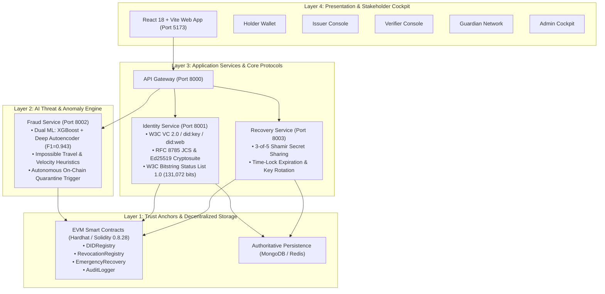

# Secure Self-Sovereign Identity Platform

> **T.C. SAKARYA UYGULAMALI BİLİMLER ÜNİVERSİTESİ - TEKNOLOJİ FAKÜLTESİ**  
> **Bilgisayar Mühendisliği Tasarımı Projesi**  
> **SECURE SELF-SOVEREIGN IDENTITY WITH AI-BASED FRAUD DETECTION AND EMERGENCY RECOVERY ON BLOCKCHAIN**  
> **Öğrenci:** Charaf Eddine Bessanane (B210109591) | **Danışman:** Dr. Öğr. Üyesi A. F. M. Suaib Akhter  

---

## 1. Project Overview

The **Secure Self-Sovereign Identity (SSI) Platform** is an enterprise-grade academic reference implementation combining **W3C Verifiable Credentials Data Model v2.0**, **Decentralized Identifiers (DID)**, **OpenID for Verifiable Credential Issuance (OID4VCI)** and **Presentations (OID4VP)**, **Hybrid AI Fraud Detection**, and **EIP-4337 Smart Contract Anchoring** with **3-of-5 Shamir Secret Sharing Social Recovery**.

The platform gives users cryptographic control over their digital credentials while enabling instant, trustless verification with zero personal data leakage.

---

## 2. Architecture & 4-Layer Stack



---

## 3. Technology Stack

| Component / Standard | Technology | Purpose | Specification |
|---|---|---|---|
| **Verifiable Credentials** | W3C VC DM v2.0 | Standardized credential claim format | [W3C Recommendation](https://www.w3.org/TR/vc-data-model-2.0/) |
| **Canonicalization** | RFC 8785 JCS | Deterministic JSON Canonicalization | [RFC 8785](https://datatracker.ietf.org/doc/html/rfc8785) |
| **Cryptographic Proofs** | `eddsa-jcs-2022` | Ed25519 signature with multibase encoding | W3C Data Integrity Cryptosuites |
| **Issuance Protocol** | OID4VCI (Draft 13) | OpenID for Verifiable Credential Issuance | OpenID Foundation |
| **Presentation Protocol**| OID4VP (Draft 20) | OpenID for Verifiable Presentations | OpenID Foundation |
| **Revocation Registry** | Bitstring Status List 1.0 | 131,072 entries, GZIP compressed, LRU cache | W3C Bitstring Status List v1.0 |
| **AI Threat Engine** | XGBoost + Autoencoder | Anomaly detection & impossible travel analysis | NIST AI Risk Management Framework |
| **Smart Contracts** | Solidity 0.8.28 | Root hash anchoring, DID registry, multi-sig | OpenZeppelin / Hardhat |
| **Backend Framework** | FastAPI (Python 3.11+) | Asynchronous REST microservices | OpenAPI 3.1 / Pydantic v2 |
| **Database Layer** | MongoDB 7.0 + Redis 7 | Compound indexed persistence + outbox queue | ACID-compliant Document Storage |
| **Frontend Cockpit** | React 18 + Vite 6 + TS | Responsive 5-stakeholder UI | Modern Vanilla CSS Design Tokens |

---

## 4. Key Features

- **Self-Sovereign Identity Ownership**: User generates and holds private keys locally; identity verified via `did:key` and `did:web`.
- **Zero-Knowledge Selective Disclosure**: Holders selectively disclose only requested claims and prove predicates (e.g. `age >= 18` or `GPA >= 3.0`) without revealing birth dates or transcripts.
- **Microsecond Cryptographic Verification**: 9-point trust verification pipeline executes cryptographic checks, status bit validation, and challenge nonce validation in $<0.2\text{ms}$.
- **Hybrid AI Fraud Defense**: Autonomous anomaly detection engine analyzes access velocity, IP geolocations, and impossible travel patterns, triggering automatic on-chain quarantine when risk exceeds thresholds.
- **Guardian Social Recovery**: Multi-sig 3-of-5 Shamir Secret Sharing recovery with time-lock delays and on-chain successor key rotation to recover lost devices without central backdoor access.

---

## 5. Prerequisites & Installation

### Host Requirements
- **Node.js**: v20.x or higher (v24 LTS recommended)
- **Python**: v3.11 or higher
- **npm**: v10.x or higher
- **Docker & Docker Compose** (Optional for containerized deployment)

### Local Environment Setup

1. **Clone repository**:
   ```bash
   git clone https://github.com/charafeddine99/secure-ssi-platform.git
   cd secure-ssi-platform
   ```

2. **Python Virtual Environment**:
   ```powershell
   python -m venv .venv
   .\.venv\Scripts\Activate.ps1
   pip install -r requirements.txt
   ```

3. **Install Frontend Dependencies**:
   ```powershell
   cd apps/web
   npm install
   cd ../..
   ```

4. **Environment Variables**:
   ```powershell
   Copy-Item .env.example .env
   ```

---

## 6. Startup Instructions

### Option A: One-Click Interactive Demo (Recommended for Evaluation)

Run the universal demo launcher:
```powershell
# Windows PowerShell
.\run_demo.ps1

# Or via Python directly
.\.venv\Scripts\python.exe scripts/start_demo.py status
.\.venv\Scripts\python.exe scripts/start_demo.py flow
```

To run individual microservices locally:
```powershell
# Terminal 1 - Frontend Web UI (Port 5173)
cd apps/web
npm run dev

# Terminal 2 - API Gateway (Port 8000)
.\.venv\Scripts\python.exe -m uvicorn services.api_gateway.app.main:app --port 8000

# Terminal 3 - Identity Service (Port 8001)
.\.venv\Scripts\python.exe -m uvicorn services.identity_service.app.main:app --port 8001

# Terminal 4 - AI Fraud Engine (Port 8002)
.\.venv\Scripts\python.exe -m uvicorn services.fraud_service.app.main:app --port 8002

# Terminal 5 - Recovery Service (Port 8003)
.\.venv\Scripts\python.exe -m uvicorn services.recovery_service.app.main:app --port 8003
```

### Option B: Containerized Docker Compose Startup

When Docker is installed and running:
```powershell
docker compose up --build
```
- **Web UI**: `http://localhost:3000` (Docker) or `http://localhost:5173` (Vite host)
- **API Gateway**: `http://localhost:8000`
- **Identity Core**: `http://localhost:8001`
- **AI Fraud Engine**: `http://localhost:8002`
- **Recovery Engine**: `http://localhost:8003`

---

## 7. Documented Demo Accounts `[DEMO ENVIRONMENT]`

The platform includes pre-configured, stateless synthetic demo personas for instantaneous evaluation:

| Role | Persona Name | Email / Username | Development Password | Portal Route | Primary Available Actions |
|---|---|---|---|---|---|
| **Holder** | Demo Holder | `holder@example.test` | `Holder-Prototype-2026!` | `/wallet` | Inspect `did:key`, receive credentials via OID4VCI, grant selective disclosure |
| **Issuer** | Demo University | `issuer@example.test` | `Issuer-Prototype-2026!` | `/issuer` | Define schema, issue W3C VC 2.0 degrees, toggle revocation bit in Bitstring list |
| **Verifier** | Demo Company | `verifier@example.test` | `Verifier-Prototype-2026!` | `/verifier` | Create OID4VP presentation requests, perform 9-point trust verification |
| **Guardian** | Demo Guardian #1 | `admin@example.test` | `Admin-Prototype-2026!` | `/guardian` | Review recovery petitions, submit Shamir key share, sign threshold approval |
| **Admin** | Demo Operator | `admin@example.test` | `Admin-Prototype-2026!` | `/admin` | System overview, EVM smart contract logs, tamper-proof audit trail, AI threat stream |

> [!NOTE]
> Evaluators can toggle between these roles with a single click using the **Sticky Top Role Switcher** or the **1-Click Quick Demo Login** on the `/login` page.

---

## 8. Golden Demo Scenario (The 2-Minute Defense Walkthrough)

Follow this fixed 8-step presentation sequence for jury evaluation:

| Step | Action | Actor | Target URL | Expected Result |
|:---:|---|---|---|---|
| **1** | **Create Credential Schema** | Issuer | `/issuer/templates` | Inspect Higher Education Degree W3C 2.0 schema and status list bit assignment |
| **2** | **Issue Credential** | Issuer | `/issuer/issue` | Input candidate details; sign with Ed25519 Data Integrity proof; generate OID4VCI offer |
| **3** | **Receive Credential** | Holder | `/wallet/scan` | Holder scans QR or accepts deep-link offer; cryptographic proof verified |
| **4** | **Inspect Wallet Portfolio** | Holder | `/wallet` | Credential appears in holder's tactile portfolio with verified issuer badge |
| **5** | **Create Verification Request** | Verifier | `/verifier/request` | Verifier creates OID4VP request specifying age check ($\ge 18$) and degree proof |
| **6** | **Selective Disclosure Consent** | Holder | `/wallet/consent` | Holder withholds GPA and National ID; submits salted blinded SHA-256 presentation |
| **7** | **9-Point Trust Audit** | Verifier | `/verifier/verify` | Verifier confirms signature, non-revocation, and predicate validity in $<0.2\text{ms}$ |
| **8** | **Tamper-Proof Audit Logging** | Admin | `/admin/audit` | Append-only event logged on Hardhat EVM smart contract with zero PII leakage |

---

## 9. Verification & Automated Testing

All platform test suites can be executed with standard commands:

```powershell
# 1. Full Platform Test Suite (550+ tests)
.\.venv\Scripts\python.exe run_tests.py

# 2. Blockchain & Smart Contracts Test Suite (19 tests)
cd blockchain
npx hardhat test
cd ..

# 3. Frontend Production Build & TypeScript Verification
cd apps/web
npm run build
cd ..

# 4. Interactive End-to-End CLI Demo Flow
.\.venv\Scripts\python.exe scripts/start_demo.py flow
```

---

## 10. Repository Structure

```text
apps/
  web/                         # React 18 + TypeScript + Vite 6 Client Cockpit
blockchain/
  contracts/                   # Solidity 0.8.28 Smart Contracts (DID, Revocation, Recovery, Audit)
  test/                        # Comprehensive Hardhat contract test suite
infrastructure/
  mongodb/                     # Database initialization scripts and index definitions
packages/
  shared/                      # Shared cryptosuites (ZKP, DIDComm v2, Schemas)
reports/
  S22_UI_UX_FINAL_REPORT.md     # Sprint 22 UI/UX Finalization Report
  S23_DEMO_AUDIT_REPORT.md      # Sprint 23 Demo Environment Audit Report
  S23_DEMO_ENVIRONMENT_FINAL_REPORT.md # Sprint 23 Final Demonstration Report
scripts/
  start_demo.py                # Universal multi-platform demo orchestrator & health monitor
  demo_runner.py               # 9-stage terminal demo script
  run_benchmarks.py            # Latency and throughput benchmarking tool
services/
  api-gateway/                 # Central routing reverse proxy
  identity-service/            # W3C VC 2.0, DID, Bitstring Status List, KMS
  fraud-service/               # XGBoost + Autoencoder AI threat detection
  recovery-service/            # 3-of-5 Shamir social recovery
```

---

## 11. Engineering Roadmap & Architecture Milestones

1. [Completed] Define the initial threat model, trust boundaries, and planned API contracts.
2. [Completed] Add the initial shared, versioned schema catalog and structural tests.
3. [Completed] Select the prototype DID methods and credential proof format through ADRs.
4. [Completed] Build resolver validation and synthetic DID fixtures required by ADR 0001.
5. [Completed] Define versioned VC fixture and verification-result models required by ADR 0002.
6. [Completed] Prototype VC Data Model 2.0 signing and verification with synthetic data.
7. [Completed] Expose the bounded local credential core through a versioned HTTP API.
8. [Completed] Add synthetic local authentication and RBAC for credential signing.
9. [Completed] Add MongoDB connection, repository, mapping, index, concurrency, and soft-delete foundations.
10. [Completed] Add MongoDB-backed credential lifecycle status, irreversible revocation, RBAC, audit events, and status/revocation APIs.
11. [Completed] Add W3C-oriented Bitstring Status List publication, stable entry assignment, caching/versioning, and durable idempotent audit outbox delivery.
12. [Completed] Add issuance-time credential-status binding, atomic persistence, configurable rollover, immutable history, and interoperability fixtures.
13. [Completed] Add short-lived multi-credential Verifiable Presentations, holder proofs, challenge/domain binding, replay protection, Mongo persistence, RBAC, and audit events.
14. [Completed] Add holder wallets, object ownership, opaque key references, server challenges, and stale-presentation reconciliation.
15. [Completed] Add provider-neutral external KMS/HSM ports
16. [Completed] Add Guardian assignments, generic M-of-N policy
17. [Next] Add explainable AI fraud detection

---

## 12. Academic Evaluation & License

Developed as a Graduation Thesis Project at Sakarya University of Applied Sciences (SUBÜ), Technology Faculty, Department of Computer Engineering.

**Developer:** Charaf Eddine Bessanane (B210109591)  
**Advisor:** Dr. Öğr. Üyesi A. F. M. Suaib Akhter  
**License:** MIT License (Academic & Research Use)
