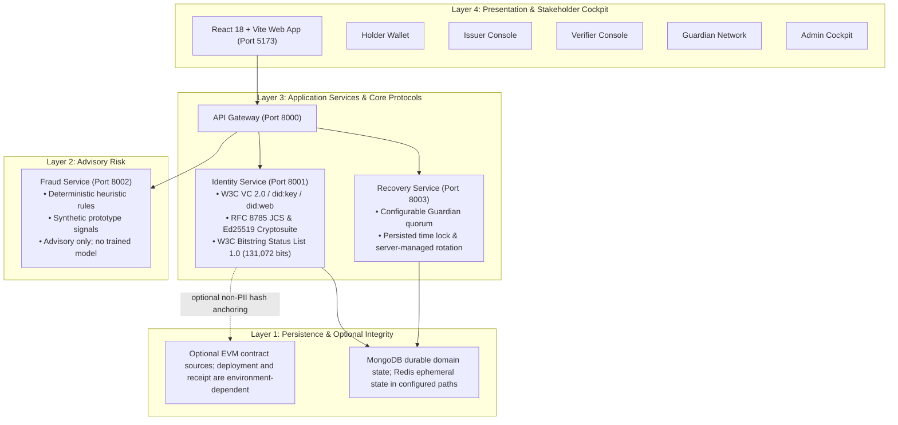

# Secure Self-Sovereign Identity Platform

> **T.C. SAKARYA UYGULAMALI BİLİMLER ÜNİVERSİTESİ - TEKNOLOJİ FAKÜLTESİ**  
> **Bilgisayar Mühendisliği Tasarımı Projesi**  
> **SECURE SELF-SOVEREIGN IDENTITY WITH AI-BASED FRAUD DETECTION AND EMERGENCY RECOVERY ON BLOCKCHAIN**  
> **Öğrenci:** Charaf Eddine Bessanane (B210109591) | **Danışman:** Dr. Öğr. Üyesi A. F. M. Suaib Akhter  
> The thesis title below describes the original research scope; it does not assert that every named capability is implemented in the current prototype.

---

## 1. Project Overview

The **Secure Self-Sovereign Identity (SSI) Platform** is an academic prototype exploring W3C Verifiable Credentials Data Model v2.0, DID methods, OpenID4VCI and OpenID4VP, advisory risk signals, Guardian recovery, and optional integrity anchoring.

This is a custodial, server-mediated web prototype, not an EUDI Wallet, certified product, or production identity service. Claim-level cryptographic selective disclosure and zero-knowledge proofs are not implemented; browser wallet and key operations cross a backend custody boundary.

---

## 2. Architecture & 4-Layer Stack



---

## 3. Technology Stack

| Component / Standard | Technology | Purpose | Specification |
|---|---|---|---|
| **Verifiable Credentials** | W3C VC DM v2.0 | Standardized credential claim format | [W3C Recommendation](https://www.w3.org/TR/vc-data-model-2.0/) |
| **Canonicalization** | RFC 8785 JCS | Deterministic JSON Canonicalization | [RFC 8785](https://datatracker.ietf.org/doc/html/rfc8785) |
| **Cryptographic Proofs** | `eddsa-jcs-2022` | Ed25519 signature with multibase encoding | W3C Data Integrity Cryptosuites |
| **Issuance Protocol** | OpenID4VCI 1.0 Final, project-supported pre-authorized flow | OpenID for Verifiable Credential Issuance | OpenID Foundation |
| **Presentation Protocol**| OpenID4VP 1.0 Final, project DCQL profile | OpenID for Verifiable Presentations | OpenID Foundation |
| **Revocation Registry** | Bitstring Status List 1.0 | 131,072 entries, GZIP compressed, LRU cache | W3C Bitstring Status List v1.0 |
| **Advisory Risk** | Deterministic heuristic over prototype signals | Advisory only; no trained model artifact or independent labelled evaluation | Project profile |
| **Optional Contracts** | Solidity sources / optional EVM bridge | Integrity hash anchoring only when a configured network and receipt are available | Optional prototype component |
| **Backend Framework** | FastAPI (Python 3.11+) | Asynchronous REST microservices | OpenAPI 3.1 / Pydantic v2 |
| **Database Layer** | MongoDB 7.0 + Redis 7 | Durable domain persistence and ephemeral state in configured paths | Service-specific repository contracts |
| **Frontend Cockpit** | React 18 + Vite 6 + TS | Responsive 5-stakeholder UI | Modern Vanilla CSS Design Tokens |

---

## 4. Key Features

- **Custodial wallet prototype**: wallet-bound issuance and holder workflows use backend-managed key operations; this is not device-bound self-custody.
- **Credential presentations**: the current Data Integrity profile presents the complete selected signed credential. Claim-level cryptographic selective disclosure, predicate proofs, and zero-knowledge proofs are not implemented.
- **Policy verification**: the backend evaluates cryptographic proof, issuer trust, status, freshness, and protocol bindings. No sub-millisecond performance guarantee is claimed.
- **Advisory risk only**: deterministic rules use synthetic prototype signals. There is no trained model artifact or independent labelled evaluation, and risk cannot establish issuer trust or credential status.
- **Guardian recovery prototype**: configurable quorum, time lock, cancellation, audit, and server-managed key successor workflow. The service verifies submitted EdDSA proofs for registered `did:key` Guardians; the prototype does not establish independent Guardian-device possession or MFA, does not support `did:web` proof verification, and centrally persists encrypted shares rather than independently delivering them.

---

## 5. Prerequisites & Installation

### Host Requirements
- **Node.js**: v20.x or higher (v24 LTS recommended)
- **Python**: v3.11 or higher
- **npm**: v10.x or higher
- **Docker & Docker Compose** (Optional for containerized deployment)

### Local Environment Setup

1. **Clone repository**:
   ```bash
   git clone https://github.com/charafeddine99/secure-ssi-platform.git
   cd secure-ssi-platform
   ```

2. **Python Virtual Environment**:
   ```powershell
   python -m venv .venv
   .\.venv\Scripts\Activate.ps1
   pip install -r requirements.txt
   ```

3. **Install Frontend Dependencies**:
   ```powershell
   cd apps/web
   npm install
   cd ../..
   ```

4. **Environment Variables**:
   ```powershell
   Copy-Item .env.example .env
   ```

---

## 6. Startup Instructions

### Option A: One-Click Interactive Demo (Recommended for Evaluation)

Run the universal demo launcher:
```powershell
# Windows PowerShell
.\run_demo.ps1

# Or via Python directly
.\.venv\Scripts\python.exe scripts/start_demo.py status
.\.venv\Scripts\python.exe scripts/start_demo.py flow
```

To run individual microservices locally:
```powershell
# Terminal 1 - Frontend Web UI (Port 5173)
cd apps/web
npm run dev

# Terminal 2 - API Gateway (Port 8000)
.\.venv\Scripts\python.exe -m uvicorn services.api_gateway.app.main:app --port 8000

# Terminal 3 - Identity Service (Port 8001)
.\.venv\Scripts\python.exe -m uvicorn services.identity_service.app.main:app --port 8001

# Terminal 4 - AI Fraud Engine (Port 8002)
.\.venv\Scripts\python.exe -m uvicorn services.fraud_service.app.main:app --port 8002

# Terminal 5 - Recovery Service (Port 8003)
.\.venv\Scripts\python.exe -m uvicorn services.recovery_service.app.main:app --port 8003
```

### Option B: Containerized Docker Compose Startup

When Docker is installed and running:
```powershell
docker compose up --build
```
- **Web UI**: `http://localhost:3000` (Docker) or `http://localhost:5173` (Vite host)
- **API Gateway**: `http://localhost:8000`
- **Identity Core**: `http://localhost:8001`
- **AI Fraud Engine**: `http://localhost:8002`
- **Recovery Engine**: `http://localhost:8003`

---

## 7. Demo and authentication boundary

The default Compose ports bind to 127.0.0.1 for local development; other
containers communicate over the private Compose network. This is not a
production exposure pattern. Use an explicitly secured edge proxy for remote
access, and do not publish MongoDB or Redis publicly.

The static Web bundle receives its Gateway URL through the VITE_API_BASE_URL
Docker build argument (default: http://localhost:8000). If Compose host ports
are remapped, rebuild the Web image with that Gateway URL; changing a
container's runtime environment does not rewrite an already-built SPA bundle.

Demo credentials are included in the web client only when it is a Vite development build and `VITE_ENABLE_DEMO_AUTH=true` is explicitly set. A normal production build does not embed them. The backend's `.test` accounts remain synthetic local fixtures, not production identities. OID4VP consent and presentation writes require a current backend token, holder role, and wallet ownership checks. Logout revokes the current token in the Identity Service process; revocation is not shared across workers or durable across restarts. The API Gateway applies process-local request limits; Identity and Recovery have no independent limiter, and Gateway limits are not distributed across workers. This prototype still has no production identity provider or MFA.

---

## 8. Evaluation flow

The UI contains a recommended Issuer → Holder → Verifier walkthrough, but the sequence is not evidence that every screen is connected to a live backend. Use a verifier-created OID4VP request and a credential returned by the authenticated holder wallet. The current W3C Data Integrity profile presents the complete selected credential; it does not prove predicates or cryptographically hide individual claims. Optional blockchain status, recovery behavior, and legacy embedded demo screens must be read from their explicit online/demo states. The current G0–G16 matrix, environment blockers, and dated test evidence are tracked in [`docs/implementation/SECURE_SSI_PLATFORM_COMPLETION_AUDIT.md`](docs/implementation/SECURE_SSI_PLATFORM_COMPLETION_AUDIT.md).

---

## 9. Verification & Automated Testing

Use the focused commands documented by the relevant service. On 24 October 2026, branch `besna-dev` at HEAD `9e965bb4de7f5e1bb1cbf0f48f30d53ebfb88b73` was revalidated: five current-working-tree application images were rebuilt without cache and recreated; all seven Compose services were healthy; focused WP-08/OID4VP tests passed **52/52**; the full Identity regression passed **708 tests with 12 environment-gated skips**; the Fraud suite passed **21/21**; and the Identity AI-policy matrix passed **8/8**. Web plus four service health routes returned HTTP 200; unauthenticated OID4VP retrieval returned HTTP 401 through both Identity and Gateway. The served Web JavaScript hash matched the local production build. The repository-wide runner was attempted twice in the follow-up but was interrupted without a test summary; its earlier same-HEAD result of 820 passed, 13 skipped, 0 failed, plus 246 subtests remains historical evidence only. WP-08 scoped L3 checks pass; suspension restoration, live authenticated browser flow, L4 interoperability, and production readiness are not claimed. npm's 2 moderate/1 high build advisories remain unassessed; the offline audit could not identify them. WP-09 now preserves the exact `[DEMO LAB / SYNTHETIC]` label in the rendered Admin risk monitor; the engine remains an untrained advisory heuristic, not production ML. Rendering, frontend lint and build were checked after the fix. See the [WP-08 acceptance report](reports/V2_1_WP08_FINAL_ACCEPTANCE.md), [WP-09 report](reports/V2_1_WP09_AI_RISK_GROUNDING.md) and [test evidence register](docs/implementation/SECURE_SSI_PLATFORM_TEST_EVIDENCE.md) for limits and exact results.

```powershell
# Root runner (known residual failures are documented in the reports)
.\.venv\Scripts\python.exe run_tests.py

# 2. Blockchain & Smart Contracts Test Suite (19 tests)
cd blockchain
npx hardhat test
cd ..

# 3. Frontend Production Build & TypeScript Verification
cd apps/web
npm run build
cd ..

# 4. Interactive End-to-End CLI Demo Flow
.\.venv\Scripts\python.exe scripts/start_demo.py flow
```

---

## 10. Repository Structure

```text
apps/
  web/                         # React 18 + TypeScript + Vite 6 Client Cockpit
blockchain/
  contracts/                   # Solidity 0.8.28 Smart Contracts (DID, Revocation, Recovery, Audit)
  test/                        # Comprehensive Hardhat contract test suite
infrastructure/
  mongodb/                     # Database initialization scripts and index definitions
packages/
  shared/                      # Shared types and schemas
reports/
  S22_UI_UX_FINAL_REPORT.md     # Sprint 22 UI/UX Finalization Report
  S23_DEMO_AUDIT_REPORT.md      # Sprint 23 Demo Environment Audit Report
  S23_DEMO_ENVIRONMENT_FINAL_REPORT.md # Sprint 23 Final Demonstration Report
scripts/
  start_demo.py                # Universal multi-platform demo orchestrator & health monitor
  demo_runner.py               # 9-stage terminal demo script
  run_benchmarks.py            # Latency and throughput benchmarking tool
services/
  api-gateway/                 # Central routing reverse proxy
  identity-service/            # W3C VC 2.0, DID, Bitstring Status List, KMS
  fraud-service/               # Synthetic-input advisory risk heuristics
  recovery-service/            # 3-of-5 Shamir social recovery
```

---

## 11. Engineering roadmap and current status

The authoritative G0–G16 gate order is in [`docs/implementation/SECURE_SSI_PLATFORM_FINAL_IMPLEMENTATION_PLAN.md`](docs/implementation/SECURE_SSI_PLATFORM_FINAL_IMPLEMENTATION_PLAN.md) and tracked in [`reports/PROJECT_WIDE_AUDIT_PROGRESS_2026-10-13.md`](reports/PROJECT_WIDE_AUDIT_PROGRESS_2026-10-13.md). Current acceptance states and evidence are in the [gate matrix](docs/implementation/SECURE_SSI_PLATFORM_GATE_ACCEPTANCE.md), [completion audit](docs/implementation/SECURE_SSI_PLATFORM_COMPLETION_AUDIT.md), and [test evidence register](docs/implementation/SECURE_SSI_PLATFORM_TEST_EVIDENCE.md). Historical sprint checklists are not the engineering source of truth. Current evidence does not establish overall completion, production readiness, or L4 interoperability.

---

## 12. Academic Evaluation & License

Developed as a Graduation Thesis Project at Sakarya University of Applied Sciences (SUBÜ), Technology Faculty, Department of Computer Engineering.

**Developer:** Charaf Eddine Bessanane (B210109591)  
**Advisor:** Dr. Öğr. Üyesi A. F. M. Suaib Akhter  
**License:** MIT License (Academic & Research Use)
