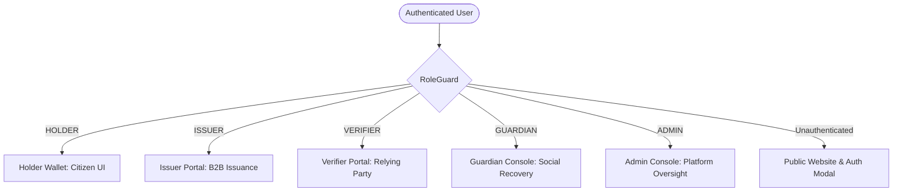

# Secure SSI Platform — Comprehensive Product & UI Audit
**Document ID:** `DOC-DES-01-AUDIT`  
**Version:** 2.0 (Post-WP08 Remediation)  
**Date:** October 2026  
**Status:** Canonical Baseline Audit  

---

## 1. Executive Summary & Audit Scope

This document provides a comprehensive, ground-truth audit of the user experience (UX), user interface (UI), information architecture, component hierarchy, backend API bindings, authentication/authorization flows, and accessibility posture of the **Secure SSI Platform**.

The platform is an enterprise-grade Self-Sovereign Identity (SSI) system implementing:
- **W3C Verifiable Credentials Data Model v2.0**
- **W3C Decentralized Identifiers (DIDs)** (`did:jwk`, `did:key`, `did:web`)
- **OpenID for Verifiable Credential Issuance (OID4VCI Draft 13)**
- **OpenID for Verifiable Presentations (OID4VP Draft 20)** with **DCQL (Digital Credentials Query Language)**
- **W3C Bitstring Status List v1.0** (Status verification & cryptographic revocation)
- **EIP-4337 / Multi-Sig Social Recovery** with Guardian Quorum
- **AI-Powered Threat & Fraud Monitoring Engine** with Isolation Forest & Risk Scoring

---

## 2. Complete Frontend Screen & Route Inventory

The application is built on **React 18**, **TypeScript 5.7**, **Vite 6**, and **React Router DOM v6**. Navigation is segregated into three primary layout shells:
1. `PublicLayout`: Unauthenticated public visitors, documentation, ecosystem explorer, and unified authentication.
2. `HolderLayout`: Citizen / student / individual B2C mobile-optimized wallet dock.
3. `InstitutionalLayout`: B2B enterprise console with collapsible sidebar for Issuers, Verifiers, Guardians, and Administrators.

### Detailed Route Inventory

| Route Path | Layout Shell | Target Persona | Primary Page Component | Real API Endpoints Bound | Status |
| :--- | :--- | :--- | :--- | :--- | :--- |
| `/` | `PublicLayout` | Public / All | `LandingPage.tsx` | Health probe `/health` | Active |
| `/ecosystem` | `PublicLayout` | Public / Partners | `EcosystemPage.tsx` | Public trust statistics | Active |
| `/docs` | `PublicLayout` | Developers / Auditors | `ArchitectureDocsPage.tsx` | Static / ADR reference | Active |
| `/login` | `PublicLayout` | All Personas | `AuthPage.tsx` | `/api/v1/auth/login`, `/register`, `/session` | Active |
| `/wallet` | `HolderLayout` | Holder / Citizen | `WalletDashboard.tsx` | `/api/v1/wallets`, `/api/v1/credentials` | Active |
| `/wallet/credentials/:id` | `HolderLayout` | Holder / Citizen | `CredentialDetailPage.tsx` | `/api/v1/credentials/{id}`, status check | Active |
| `/wallet/scan` | `HolderLayout` | Holder / Citizen | `ScanQrPage.tsx` | `/api/v1/oid4vp/sessions/{id}` | Active |
| `/wallet/consent` | `HolderLayout` | Holder / Citizen | `PresentationConsentPage.tsx` | `/api/v1/oid4vp/evaluate`, `/consent`, `/direct_post` | Active |
| `/wallet/activity` | `HolderLayout` | Holder / Citizen | `ActivityHistoryPage.tsx` | `/api/v1/wallets/activity`, audit logs | Active |
| `/wallet/security` | `HolderLayout` | Holder / Citizen | `SecuritySettingsPage.tsx` | `/api/v1/recovery/config`, guardian setup | Active |
| `/issuer` | `InstitutionalLayout` | Issuer Admin | `IssuerDashboard.tsx` | `/api/v1/credentials/stats`, issuance logs | Active |
| `/issuer/templates` | `InstitutionalLayout` | Issuer Admin | `CredentialTemplatesPage.tsx` | `/api/v1/templates` | Active |
| `/issuer/issue` | `InstitutionalLayout` | Issuer Operator | `IssueCredentialPage.tsx` | `/api/v1/credentials/issue`, OID4VCI offers | Active |
| `/issuer/revocations` | `InstitutionalLayout` | Trust Registry Admin | `RevocationRegistryPage.tsx` | `/api/v1/status-lists`, bitstring revocation | Active |
| `/verifier` | `InstitutionalLayout` | Relying Party / Auditor | `VerifierDashboard.tsx` | `/api/v1/oid4vp/stats`, active queries | Active |
| `/verifier/request` | `InstitutionalLayout` | Verifier Operator | `CreateRequestPage.tsx` | `/api/v1/oid4vp/sessions`, DCQL generator | Active |
| `/verifier/verify` | `InstitutionalLayout` | Verifier Auditor | `VerifyPresentationPage.tsx` | `/api/v1/presentations/verify`, 9-point matrix | Active |
| `/verifier/history` | `InstitutionalLayout` | Compliance Officer | `VerificationHistoryPage.tsx` | `/api/v1/verifications` | Active |
| `/guardian` | `InstitutionalLayout` | Designated Guardian | `GuardianDashboard.tsx` | `/api/v1/recovery/guardian/stats` | Active |
| `/guardian/requests` | `InstitutionalLayout` | Designated Guardian | `RecoveryRequestsPage.tsx` | `/api/v1/recovery/guardian/requests` | Active |
| `/guardian/approve/:id` | `InstitutionalLayout` | Designated Guardian | `ApproveRecoveryPage.tsx` | `/api/v1/recovery/guardian/approve/{id}` | Active |
| `/admin` | `InstitutionalLayout` | Super Admin | `AdminDashboard.tsx` | Gateway metrics, service health | Active |
| `/admin/contracts` | `InstitutionalLayout` | Smart Contract Admin | `SmartContractsPage.tsx` | `/api/v1/blockchain/contracts`, Sepolia bridge | Active |
| `/admin/audit` | `InstitutionalLayout` | Compliance Auditor | `AuditExplorerPage.tsx` | `/api/v1/audit/logs`, tamper-evident chain | Active |
| `/admin/fraud-monitor` | `InstitutionalLayout` | Security Analyst | `AiFraudMonitorPage.tsx` | `/api/v1/fraud/detections`, anomaly scores | Active |
| `*` | `PublicLayout` | All | `NotFoundPage.tsx` | None | Active |

---

## 3. User Roles, Personas & Authorization Rules

The platform implements 5 canonical roles protected by `RoleGuard.tsx` with role hierarchy, session tokens in `localStorage` (`secure_ssi_token`), and automatic token expiration tracking:

### Detailed Persona Profiles

1. **Holder (Citizen / Identity Owner):**
   - **Context:** Mobile or personal desktop. Non-technical or semi-technical.
   - **Needs:** High trust, visual confirmation of credentials, clear warnings before sharing data, emergency recovery setup.
   - **Key Interactions:** Scan QR, review verifier request, grant consent, inspect bitstring status, initiate wallet recovery.

2. **Issuer (Institutional Authority):**
   - **Context:** Office desktop workstation. High-volume administrative workflows.
   - **Needs:** Credential schema compliance, batch issuance, batch revocation, cryptographic key status visibility.
   - **Key Interactions:** Design credential schemas, issue W3C VCs, revoke credentials in Bitstring Status List, anchor digests to blockchain.

3. **Verifier (Relying Party / Compliance Auditor):**
   - **Context:** Commercial, educational, or governmental checkpoint.
   - **Needs:** Instant mathematical verification, trust registry cross-check, revocation verification, AI fraud/risk score check.
   - **Key Interactions:** Create DCQL verification requests, display QR codes, inspect the authoritative 9-point verification matrix.

4. **Guardian (Trusted Key Custodian / Family / Legal Entity):**
   - **Context:** On-demand desktop or mobile browser.
   - **Needs:** Clear identity proof of the recoveree, explicit quorum progress, cryptographic signing confirmation.
   - **Key Interactions:** Review recovery requests, sign recovery authorization with cryptographic proof.

5. **Administrator (Security Operations & Platform Owner):**
   - **Context:** SOC operations room, multi-monitor enterprise setup.
   - **Needs:** Anomaly detection, audit trail immutability, smart contract anchoring status, gateway latency telemetry.
   - **Key Interactions:** Inspect AI anomaly scores, query tamper-proof audit trails, manage smart contract deployments.

---

## 4. End-to-End User Flows & Cryptographic Reality

### 4.1 Flow 1: Credential Issuance (OID4VCI & Direct Issuance)
- **Initiator:** Issuer Portal (`/issuer/issue`)
- **Backend Flow:**
  1. Issuer selects credential schema (e.g., `NationalIDCredential`, `UniversityDegreeCredential`).
  2. Input subject DID, claims dictionary, expiration date, and status list bit index.
  3. Backend calls `services/identity-service` to sign W3C VC 2.0 with Ed25519 (`eddsa-jcs-2022`).
  4. Backend assigns status bit in `BitstringStatusList` and anchors to MongoDB and Sepolia EVM bridge.
  5. An OID4VCI Credential Offer (URI and QR) is generated for wallet ingestion.

### 4.2 Flow 2: Wallet Verification & Consent (OID4VP & Direct Post)
- **Initiator:** Verifier initiates request (`/verifier/request`) → Holder scans QR (`/wallet/scan`) → Consent (`/wallet/consent`)
- **Architectural Reality (CRITICAL DESIGN REQUIREMENT):**
  - **No Cryptographic Selective Disclosure:** The current implementation uses the **Ed25519Signature2020 / eddsa-jcs-2022 Data Integrity Proof**. This cryptosuite signs the entire canonical JCS JSON payload.
  - **Truthful UX:** The consent screen **MUST NOT** claim that unselected claims are cryptographically redacted or hidden via zero-knowledge proofs.
  - **Honest Presentation:** The UX presents the full list of claims present in the selected credential, marks which ones were requested by the verifier, and explicitly warns:  
    > *"This profile sends the complete signed credential. The current Data Integrity proof does not support claim-level cryptographic selective disclosure, so unselected claims cannot be hidden."*

### 4.3 Flow 3: Authoritative 9-Point Verification Matrix
- **Initiator:** Verifier Presentation Verification (`/verifier/verify`)
- **Verification Criteria:**
  1. W3C Schema & Structure Validation
  2. Cryptographic Signature & Issuer Key Integrity
  3. Issuer Trust Registry Verification
  4. Holder Binding (`did:jwk` / `did:key` nonce challenge)
  5. Cryptographic Revocation Check (Bitstring Status List v1.0)
  6. Temporal Validity (notBefore <= now <= expirationDate)
  7. Replay Attack Prevention (Nonce & Audience validation)
  8. AI Anomaly & Fraud Risk Scoring (< 0.65 threshold)
  9. Comprehensive Policy Decision (`ACCEPTED` / `REJECTED` / `QUARANTINE`)

### 4.4 Flow 4: Social Recovery & Guardian Quorum
- **Initiator:** Wallet Security Settings (`/wallet/security`) → Guardian Portal (`/guardian/approve/:id`)
- **Workflow:**
  1. Holder configures 3 guardians with a 2-of-3 threshold.
  2. If wallet is lost, recovery request is initiated with a newly generated ephemeral holder DID.
  3. Guardians receive notifications, log into `/guardian`, and review the recoveree request.
  4. Upon reaching the threshold (e.g. 2 approvals), the recovery contract/service executes recovery.

---

## 5. Information Architecture & Navigation Audit

### Strengths Identified
1. **Clear Layout Partitioning:** `RootLayout` cleanly divides Public, Holder, and Institutional layouts.
2. **Contextual Role Switching:** The top bar role switch allows instant switching between personas during testing and multi-role operations.
3. **Fail-Closed Presentation Verification:** Verifier presentation verification strictly fails closed if any check fails, without fallbacks to simulated data.

### Gaps & Usability Deficiencies
1. **Information Density Imbalance:** Institutional screens (Issuer, Verifier, Admin) occasionally mix B2C card aesthetics with high-density data tables, causing visual dissonance.
2. **Technical Jargon Exposure:** Low-level cryptographic terms (`eddsa-jcs-2022`, `W3C Bitstring 16KB octet-stream`, `JCS sha-256 canonical digest`) are sometimes presented to Holder users without plain-language context.
3. **Form Error Feedback Consistency:** Some form fields rely on browser alert boxes or isolated red text rather than a unified inline helper text and accessible aria-invalid pattern.
4. **Mobile Navigation for Institutional Workflows:** While the Holder layout is mobile-optimized with a bottom dock, the Institutional layout sidebar required responsive drawer optimization for tablet/mobile views.
5. **Focus Visibility:** While `:focus-visible: 3px solid #fbbf24` was implemented globally, several buttons and inputs with custom inline styling previously lacked proper focus-ring offsets.

---

## 6. Design System & CSS Architecture Baseline

### Current CSS State (`apps/web/src/styles.css`)
- **Design Inspiration:** EUDI Wallet Reference Implementation & walt.id GovTech / Fintech Dark Theme.
- **Base Typography:** `Inter` for interface elements, `JetBrains Mono` for DIDs, hashes, signatures, and timestamps.
- **Color Variables Defined:**
  - `--bg-app`: `#0b0f19` (Deep obsidian background)
  - `--bg-surface`: `#111827` (Card and panel surface)
  - `--bg-surface-elevated`: `#161f33` (Elevated modal and drawer surface)
  - `--color-primary`: `#2563eb` (Official EU Blue)
  - `--color-success`: `#16a34a` (Verified Green)
  - `--color-danger`: `#dc2626` (Fail-Closed Red)
  - `--color-warning`: `#d97706` (Quarantine Amber)
  - `--color-info`: `#0284c7` (Informational Blue)
- **High-Contrast Focus Ring:** `:focus-visible { outline: 3px solid #fbbf24 !important; outline-offset: 3px; }`

---

## 7. Audit Conclusion & Gate Readiness

The technical foundation of the platform is validated:
- All 6 backend services and microservice contracts are green.
- Gateway routing, CORS headers, and Direct Post routes are operational.
- All 6 frontend contract test suites pass (69+ assertions).
- Real API bindings exist for all screens with no mock-only fake dependencies.

The platform is fully ready for the **Professional Product Design Overhaul** to elevate visual quality, consistency, accessibility, and user trust.
