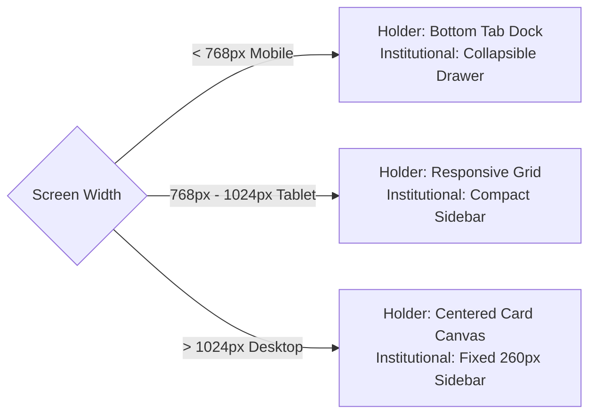

# Design Strategy & Brand Direction
**Document ID:** `DOC-DES-03-STRATEGY`  
**Version:** 1.0  
**Date:** October 2026  
**Status:** Approved Strategic Baseline  

---

## 1. Product Vision & Target Audience

The **Secure SSI Platform** is a sovereign digital identity infrastructure designed to bridge the trust gap between individual citizens (Holders), issuing authorities (Universities, Governments, Banks), and relying parties (Verifiers, Employers, Service Providers).

### Target Audiences & Contexts of Use

| Persona Group | Primary Users | Primary Device | Usage Context | Cognitive Load Tolerance |
| :--- | :--- | :--- | :--- | :--- |
| **Citizen Holders** | Students, professionals, citizens | Mobile (iOS/Android), Laptop | Personal privacy, credential presentation, login, account recovery | **Low:** Needs immediate clarity, zero jargon, and reassurance against data leaks. |
| **Issuing Authorities** | Registrars, HR managers, compliance clerks | Desktop Workstation | High-volume issuance, schema definition, status revocation | **Medium-High:** Focuses on throughput, batch accuracy, and validation feedback. |
| **Relying Parties** | Border control, HR recruiters, auditors, gatekeepers | Tablet / Desktop | Real-time credential verification, fraud detection, DCQL requests | **High Speed:** Needs instant green/red binary outcomes backed by forensic details. |
| **Guardians** | Trusted contacts, corporate legal officers | Mobile / Laptop | Multi-sig quorum approvals, identity recovery confirmation | **Low-Medium:** High security stakes; needs clear identity verification of recoveree. |
| **System Administrators** | Security engineers, blockchain DevOps | Multi-monitor Desktop | Smart contract gas monitoring, AI fraud anomaly tuning, audit logs | **High:** Requires deep telemetry, query filters, and system-wide health indicators. |

---

## 2. Core Design Principles

### Principle 1: Radical Cryptographic Honesty
The interface must never mislead users about what cryptography does or does not protect:
- When using `eddsa-jcs-2022`, the whole signed credential is sent. The UI clearly states this fact.
- Simulated states must never masquerade as authoritative blockchain or status-list proofs.
- If a verification check fails or is unavailable, the UI fails closed immediately.

### Principle 2: Proportionate Information Density
- **B2C Citizen Wallet:** High whitespace, generous touch targets (min 44x44px), card metaphors, and progressive disclosure for raw JSON.
- **B2B Institutional Console:** High density, compact tables, split-screen verification matrices, and immediate access to cryptographic digests.

### Principle 3: Multi-Sensory Status & Accessibility
Status is never conveyed by color alone:
- Every status pill pairs color (`#16a34a`, `#dc2626`, `#d97706`, `#0284c7`) with explicit textual state (`VERIFIED`, `REVOKED`, `QUARANTINE`, `PENDING`) and a corresponding Lucide icon (`ShieldCheck`, `XCircle`, `AlertTriangle`, `Clock`).
- High-contrast `:focus-visible` ring (`#61dfd0`, 3px solid, 3px offset) keeps keyboard focus visible while reserving amber for warning and expiry states.

### Principle 4: Error Prevention & Informed User Control
- Destructive operations (Revoking a credential, approving a social recovery quorum, rejecting a presentation) require clear confirmation modals.
- Critical actions feature prominent Cancel / Abort pathways with zero penalty.

---

## 3. Comparative Evaluation of Design Directions

To establish a coherent brand character, we evaluated two distinct aesthetic and functional directions:

```mermaid
graph TD
    subgraph Direction A: "Light Fintech Minimalist"
        A1[Light surfaces #FFFFFF / #F8FAFC]
        A2[Light gray borders #E2E8F0]
        A3[Vibrant Blue Accents #2563EB]
        A4[High glare in SOC / dark environments]
    end
    subgraph Direction B: "GovTech Sovereign Dark"
        B1[Deep obsidian background #0B0F19]
        B2[Elevated slate surfaces #111827 / #161F33]
        B3[High contrast text #F8FAFC, 14.8:1 contrast]
        B4[Official EU Blue #2563EB & Amber-400 focus #FBBF24]
    end
```

### Direction A: Light Fintech Minimalist
- **Visuals:** Pure white backgrounds (`#ffffff`), soft slate cards (`#f8fafc`), subtle shadows, and light blue accents.
- **Advantages:** Familiar to general web users; feels like a modern SaaS dashboard.
- **Disadvantages:**
  - High eye strain in 24/7 security operations centers (SOC) and server monitoring rooms.
  - Reduced contrast for subtle status badges and security risk meters.
  - Less psychological association with high-security cryptographic infrastructure.
  - Requires maintaining dual themes, increasing CSS footprint and regression surface area.

### Direction B: GovTech Sovereign Dark (Chosen Direction)
- **Visuals:** Obsidian slate foundation (`#0b0f19`), elevated panel surfaces (`#111827`), high-contrast text (`#f8fafc`, 14.8:1 contrast ratio), deep borders (`#1f2937`), and official EU blue brand accents (`#2563eb`).
- **Advantages:**
  - **Uncompromising Contrast:** Surpasses WCAG 2.2 AAA text contrast across all primary surfaces.
  - **Security Authority:** Conveys sovereign, military-grade, and institutional trustworthiness.
  - **Battery & Eye Fatigue Efficiency:** Optimized for OLED mobile devices and prolonged enterprise use.
  - **Status Pop:** Green (`#22c55e`), Red (`#f87171`), and Amber (`#fbbf24`) status indicators are instantly distinguishable against dark surfaces.

### Decision Rationale
**Direction B (GovTech Sovereign Dark)** is officially selected. It aligns perfectly with the European Digital Identity (EUDI) reference architecture, provides superior contrast readability, and establishes an authoritative visual presence.

---

## 4. Typography & Information Hierarchy Strategy

1. **Primary Interface Font:** **Inter** (Google Fonts / System Fallback: `-apple-system, BlinkMacSystemFont, Segoe UI, Roboto, sans-serif`).
   - Selected for optical neutrality, tall x-height, and exceptional legibility at small sizes (11px–13px).
2. **Cryptographic & Telemetry Font:** **JetBrains Mono** (Fallback: `monospace`).
   - Used for all DIDs (`did:jwk:eyJ...`), transaction hashes, cryptographic digests, bit indices, and timestamps.
   - Prevents optical character confusion between `0` and `O`, or `1`, `l`, and `I`.
3. **Truncation & Copyability:**
   - Any DID or hash exceeding 24 characters uses middle truncation (`did:jwk:eyJ...38a9`) in tabular views, accompanied by a 1-click clipboard copy button with visual confirmation.

---

## 5. Responsive & Layout Architecture



### Responsive Breakpoints
- **Mobile (`< 768px`):**
  - Holder Wallet displays sticky bottom dock with 5 core actions (Wallet, Scan, Consent, Activity, Security).
  - Institutional layouts collapse sidebar into a high-contrast slide-out drawer triggered by header burger menu.
  - Data tables switch to card-list mode to eliminate horizontal scrolling.
- **Tablet (`768px – 1024px`):**
  - Dual-column layouts collapse to single-column with vertical stacking.
  - Verification matrix adapts to full-width stacked checklist.
- **Desktop (`> 1024px`):**
  - Fixed 260px institutional sidebar with grouped navigational categories.
  - Side-by-side presentation of DCQL request builder and live QR verification terminal.
  - Max container width capped at `1440px` for optimal eye scanning geometry.

---

## 6. Strategic Alignment with Requirements

This strategy ensures that every pixel, token, component, and interaction is engineered for:
1. **WCAG 2.2 AA Compliance:** High contrast, visible focus rings, non-color status indicators, and keyboard trapping prevention.
2. **Cryptographic Rigor:** Explicit full-credential disclosure notices, fail-closed verifier pipelines, and authentic status representations.
3. **Enterprise Usability:** Rapid task completion for institutional operators and friction-free sovereignty for citizens.
