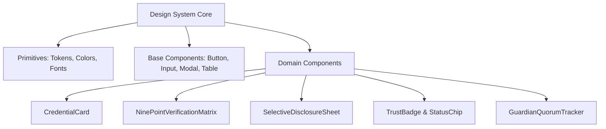

# Full Design System Architecture
**Document ID:** `DOC-DES-04-SYSTEM`  
**Version:** 2.0  
**Date:** October 2026  
**Status:** Approved Design System  

---

## 1. Design System Philosophy

The **Secure SSI Platform Design System** is an enterprise-grade, accessible, and mathematically precise design system created specifically for cryptographic identity platforms, government credentialing, and multi-tenant verifier ecosystems.

### Core Tenets
1. **Predictability:** Every interaction behaves consistently across all 6 portals.
2. **Accessible by Construction:** High contrast (WCAG 2.2 AAA on primary surfaces), prominent focus rings, explicit screen-reader text, and non-reliance on color alone.
3. **Information Density with Breathing Room:** Dense data presentations for institutional auditors paired with generous touch ergonomics for citizen wallet users.
4. **Honest Cryptographic Semantics:** Clear visual metaphors that represent real cryptographic states without false security promises.

---

## 2. Foundation: Layout, Grids & Responsive Breakpoints

### 2.1 Spatial Scale (8-Point Grid System)
All spacing, padding, margins, and component dimensions adhere to a strict geometric scale:

| Token Name | Value | Purpose |
| :--- | :--- | :--- |
| `space-1` | `4px` | Micro gaps, badge inner padding, border offsets |
| `space-2` | `8px` | Icon-to-text spacing, compact button padding, input internal padding |
| `space-3` | `12px` | Standard element gap, table cell vertical padding, card inner margins |
| `space-4` | `16px` | Standard container padding, form field vertical spacing |
| `space-5` | `20px` | Panel padding, header vertical alignment |
| `space-6` | `24px` | Section margins, modal internal padding, desktop header spacing |
| `space-8` | `32px` | Major section breaks, dashboard grid gaps |
| `space-12` | `48px` | Hero section margins, landing page divider gaps |

### 2.2 Breakpoint Specifications

```
+-------------------------------------------------------------------------+
| Breakpoint | Viewport Range | Layout Behavior                          |
+-------------------------------------------------------------------------+
| Mobile     | 0px - 767px    | Single column, sticky bottom dock (44px) |
| Tablet     | 768px - 1023px | Collapsible drawer, responsive grid     |
| Desktop    | 1024px - 1439px| Fixed 260px sidebar, multi-pane console  |
| Ultra-Wide | >= 1440px      | Centered 1440px max-width container      |
+-------------------------------------------------------------------------+
```

### 2.3 Structural Surfaces & Elevation

- **Foundation Background (`--bg-app: #0b0f19`):** Pure obsidian slate canvas.
- **Card / Surface (`--bg-surface: #111827`):** Base layer for all panels, data tables, and cards. Border: `1px solid #1f2937`. Radius: `10px`.
- **Elevated Surface (`--bg-surface-elevated: #161f33`):** Modals, flyout menus, and active table header rows. Border: `1px solid #2d3748`. Elevation: `0 12px 32px rgba(0,0,0,0.6)`.
- **Input Surface (`--bg-input: #070a12`):** Sunken surface for form inputs and code blocks. Border: `1px solid #1f2937`.

---

## 3. Navigation Paradigms

### 3.1 Global Top Bar (`enterprise-header`)
- **Height:** 64px fixed.
- **Sticky Behavior:** `position: sticky; top: 0; z-index: 50;`.
- **Contents:**
  1. Brand Logo Badge (`SSI` monogram, 36x36px, EU Blue background).
  2. Brand Main Title ("SECURE SSI PLATFORM") + Version/Environment Badge (`v2.1-PROD`).
  3. Interactive Role Switcher Bar (5 canonical roles: `HOLDER`, `ISSUER`, `VERIFIER`, `GUARDIAN`, `ADMIN`).
  4. Network Health Indicator (Active Gateway, Sepolia EVM status, MongoDB latency).
  5. Session State & Logout / Switch Identity Trigger.

### 3.2 Institutional Navigation Sidebar (`enterprise-sidebar`)
- **Width:** 260px desktop.
- **Organization:** Grouped by functional domain with category headers (`OVERVIEW`, `OPERATIONS`, `SECURITY & AUDIT`).
- **Interactive State:** Active links receive EU Blue background (`#2563eb`), white text, and bold weight. Hover links receive subtle highlight (`#1e293b`).

### 3.3 Citizen Mobile Bottom Dock (`holder-bottom-dock`)
- **Height:** 64px.
- **Position:** `position: fixed; bottom: 0; left: 0; right: 0; z-index: 45;`.
- **Items:** 5 primary touch items:
  1. `Wallet` (Home / Credential list)
  2. `Scan` (QR scanner / Presentation initiator)
  3. `Consent` (Active presentation session review)
  4. `Activity` (Audit trail & history)
  5. `Security` (Guardians & social recovery)

---

## 4. Component Taxonomy & Architectural Hierarchy



### 4.1 Base Components
- **Buttons (`.btn`):**
  - Primary (`.btn-primary`): `#2563eb`, hover `#1d4ed8`, active `#1e40af`. White text.
  - Secondary (`.btn-secondary`): `#1e293b`, border `#2d3748`, text `#cbd5e1`.
  - Danger (`.btn-danger`): Dark red background `rgba(220, 38, 38, 0.15)`, border `rgba(220, 38, 38, 0.35)`, text `#f87171`.
  - Ghost / Icon-only (`.btn-ghost`): Transparent background, hover `#1e293b`, text `#94a3b8`.
- **Inputs & Form Controls:**
  - Sunken dark background (`#070a12`), 1px solid `#1f2937` border, focus ring `#61dfd0`.
  - Clear label with `htmlFor` association, mandatory asterisk `*` in red, and dedicated error container with `aria-live="polite"`.

### 4.2 Domain-Specific Identity Components
1. **`CredentialCard`:**
   - Visual digital passport style card.
   - Header with Credential Title, Issuer Badge, and Expiration Date.
   - Distinct gradient accent line indicating credential status (Active = Green, Revoked = Red, Expired = Amber).
   - Expandable claim tray showing all signed claims.
2. **`TrustBadge`:**
   - Authoritative issuer certification badge (`W3C TRUSTED ISSUER`, `REVOKED`, `UNTRUSTED`).
   - Pairs institutional seal icon with cryptographic verification hash.
3. **`NinePointVerificationMatrix`:**
   - The authoritative 9-step cryptographic verification engine output.
   - Displays each check with pass/fail/quarantine state, execution latency, and technical diagnostic evidence.
4. **`SelectiveDisclosureSheet` & Consent Page:**
   - Full disclosure notice for `eddsa-jcs-2022`.
   - Comprehensive claim inventory highlighting requested claims vs extra claims.
   - Explicit confirmation checkbox before release.

---

## 5. Iconography Guidelines

The platform exclusively uses **Lucide React** (`lucide-react`) icons with standard 16px, 18px, and 20px optical sizes:

| Meaning | Icon Component | Approved Token Color |
| :--- | :--- | :--- |
| Verified / Approved / Authoritative | `ShieldCheck`, `CheckCircle2` | `#22c55e` (Green) |
| Revoked / Failed / Security Alert | `XCircle`, `ShieldAlert` | `#ef4444` (Red) |
| Quarantine / Warning / Review | `AlertTriangle`, `Clock` | `#fbbf24` (Amber) |
| Information / DID / Details | `Info`, `KeyRound`, `Hash` | `#38bdf8` (Sky) |
| Identity / Holder / Subject | `UserCheck`, `Wallet` | `#60a5fa` (Blue) |
| Copy to Clipboard | `Copy`, `Check` | `#94a3b8` / `#22c55e` |
| Refresh / Sync / In-Progress | `RefreshCw` (with `.spin`) | `#60a5fa` |

**Rule:** An icon must never be rendered as the sole indicator of state without an accompanying text label or accessible `aria-label`.
