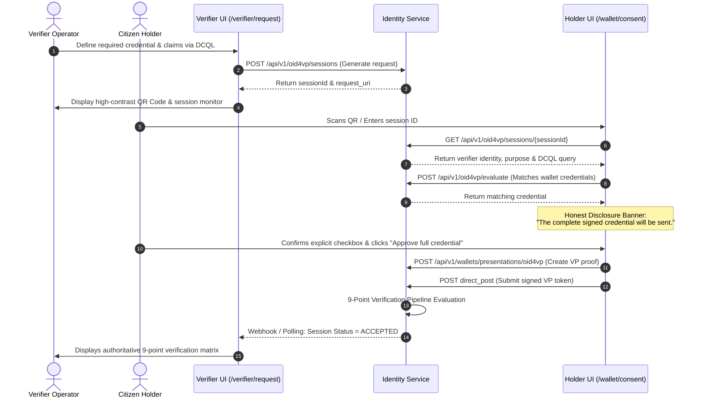
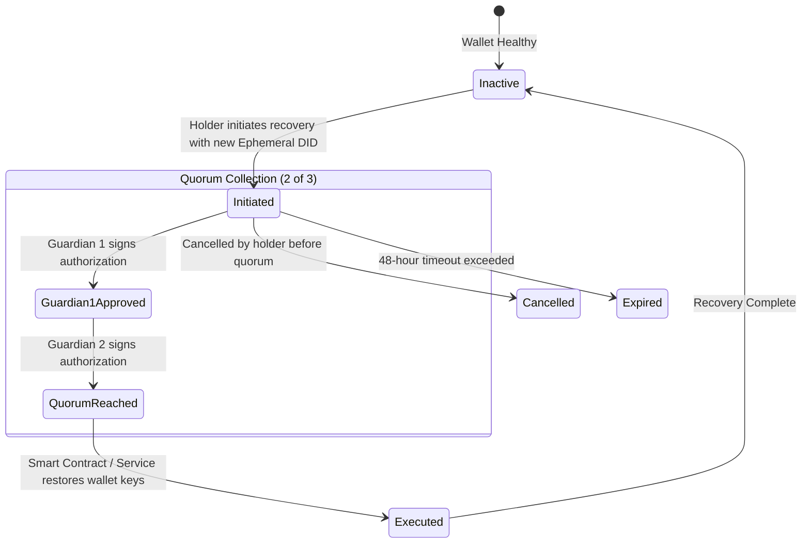

# Screen Inventory & End-to-End User Flows
**Document ID:** `DOC-DES-07-FLOWS`  
**Version:** 2.0  
**Date:** October 2026  
**Status:** Approved Navigation & Flow Architecture  

---

## 1. Complete Screen Matrix

The **Secure SSI Platform** encompasses 22 distinct operational and public screens grouped into 6 logical portal categories:

```mermaid
graph TD
    Root([Secure SSI Platform]) --> Public[Public & Auth Portal]
    Root --> Holder[Holder Wallet Portal]
    Root --> Issuer[Issuer Portal]
    Root --> Verifier[Verifier Portal]
    Root --> Guardian[Guardian Recovery Portal]
    Root --> Admin[Admin & Security Cockpit]
    
    Public --> P1[Landing Page]
    Public --> P2[Ecosystem Explorer]
    Public --> P3[Architecture Docs]
    Public --> P4[Authentication Modal/Page]
    
    Holder --> H1[Wallet Dashboard]
    Holder --> H2[Credential Details]
    Holder --> H3[Scan QR / Offer Ingestion]
    Holder --> H4[Presentation Consent]
    Holder --> H5[Activity History]
    Holder --> H6[Security & Guardian Settings]
    
    Issuer --> I1[Issuer Dashboard]
    Issuer --> I2[Credential Templates Catalog]
    Issuer --> I3[Issue Credential Console]
    Issuer --> I4[Revocation & Status List Registry]
    
    Verifier --> V1[Verifier Dashboard]
    Verifier --> V2[Create DCQL Request]
    Verifier --> V3[Verify Presentation Console]
    Verifier --> V4[Verification Audit History]
    
    Guardian --> G1[Guardian Dashboard]
    Guardian --> G2[Recovery Requests List]
    Guardian --> G3[Approve Recovery Console]
    
    Admin --> A1[Admin Infrastructure Dashboard]
    Admin --> A2[Smart Contracts & EVM Bridge]
    Admin --> A3[Audit Explorer & Chain Verification]
    Admin --> A4[AI Fraud & Threat Cockpit]
```

---

## 2. Comprehensive Screen Inventory Table

| ID | Screen Name | Route Path | Authorized Roles | Primary Architectural Purpose |
| :--- | :--- | :--- | :--- | :--- |
| **SCR-PUB-01** | Landing Page | `/` | All / Public | Platform value proposition, feature highlights, trust metrics |
| **SCR-PUB-02** | Ecosystem Explorer | `/ecosystem` | All / Public | Public trust registry explorer, verified issuer directory |
| **SCR-PUB-03** | Architecture Docs | `/docs` | All / Public | Technical standards reference (W3C VC 2.0, OID4VP, DCQL) |
| **SCR-PUB-04** | Unified Auth Page | `/login` | All / Public | Role-based authentication, wallet connection, session management |
| **SCR-HLD-01** | Wallet Dashboard | `/wallet` | `HOLDER` | Digital credential cards, total credentials count, quick actions |
| **SCR-HLD-02** | Credential Details | `/wallet/credentials/:id` | `HOLDER` | Raw claim inspection, bitstring status check, QR export |
| **SCR-HLD-03** | Scan QR Page | `/wallet/scan` | `HOLDER` | Camera scanner & manual request URI input for OID4VP |
| **SCR-HLD-04** | Presentation Consent | `/wallet/consent` | `HOLDER` | Honest consent screen, complete credential disclosure notice |
| **SCR-HLD-05** | Activity History | `/wallet/activity` | `HOLDER` | Personal presentation logs, verifier requests, issuance history |
| **SCR-HLD-06** | Security & Guardians | `/wallet/security` | `HOLDER` | Social recovery configuration, guardian threshold management |
| **SCR-ISS-01** | Issuer Dashboard | `/issuer` | `ISSUER` | Issuance metrics, active status list capacity, recent credentials |
| **SCR-ISS-02** | Credential Templates| `/issuer/templates` | `ISSUER` | Schema catalog (National ID, University Degree, Health Pass) |
| **SCR-ISS-03** | Issue Credential | `/issuer/issue` | `ISSUER` | W3C VC 2.0 form builder, Ed25519 signing, OID4VCI offer |
| **SCR-ISS-04** | Revocation Registry | `/issuer/revocations` | `ISSUER` | Bitstring Status List v1.0 management, bit toggling |
| **SCR-VRF-01** | Verifier Dashboard | `/verifier` | `VERIFIER` | Active verification sessions, fraud alerts, acceptance rate |
| **SCR-VRF-02** | Create Request | `/verifier/request` | `VERIFIER` | DCQL query builder, QR code terminal, presentation request URI |
| **SCR-VRF-03** | Verify Presentation | `/verifier/verify` | `VERIFIER` | Authoritative 9-point verification matrix, fail-closed results |
| **SCR-VRF-04** | Verification History| `/verifier/history` | `VERIFIER` | Historical audit logs of presented credentials and outcomes |
| **SCR-GRD-01** | Guardian Dashboard | `/guardian` | `GUARDIAN` | Pending recovery requests, assigned protected identities |
| **SCR-GRD-02** | Recovery Requests | `/guardian/requests` | `GUARDIAN` | Queue of active wallet recovery requests requiring quorum |
| **SCR-GRD-03** | Approve Recovery | `/guardian/approve/:id`| `GUARDIAN` | Cryptographic signature authorization for identity restore |
| **SCR-ADM-01** | Admin Cockpit | `/admin` | `ADMIN` | System-wide microservice health, API gateway latency |
| **SCR-ADM-02** | Smart Contracts | `/admin/contracts` | `ADMIN` | Sepolia EVM bridge, anchor contract addresses, gas metrics |
| **SCR-ADM-03** | Audit Explorer | `/admin/audit` | `ADMIN` | Immutable hash-chained audit log explorer, tamper checks |
| **SCR-ADM-04** | AI Fraud Monitor | `/admin/fraud-monitor`| `ADMIN` | Isolation Forest anomaly engine telemetry, threat matrix |

---

## 3. End-to-End User Flow State Machines

### 3.1 Flow 1: Verification & Presentation Lifecycle (OID4VP / DCQL / Direct Post)

### 3.2 Flow 2: Social Recovery with Guardian Quorum

---

## 4. Key Failure & Recovery Scenarios

1. **Network Disruption during Presentation Submission:**
   - If the direct post transmission fails, `getOid4vpSubmissionErrorMessage` detects the stage (`CREATION`, `DIRECT_POST`, `SESSION_UPDATE`).
   - The user is provided an actionable recovery button: *"Retry Submission"* without having to re-scan the QR code if the cryptographic proof is still cached in state.
2. **Untrusted Issuer or Revoked Credential:**
   - If the Verifier evaluates a presentation containing a revoked credential, the `NinePointVerificationMatrix` immediately flags Gate 5 (`Bitstring Status List`) in red (`REVOKED`) and sets the overarching policy result to `REJECTED`.
3. **AI Anomaly Detection Triggered (Score >= 0.65):**
   - High velocity or mismatched geo-telemetry routes the session into `QUARANTINE`.
   - The Verifier screen displays an amber alert with recommended manual identity inspection procedures.
