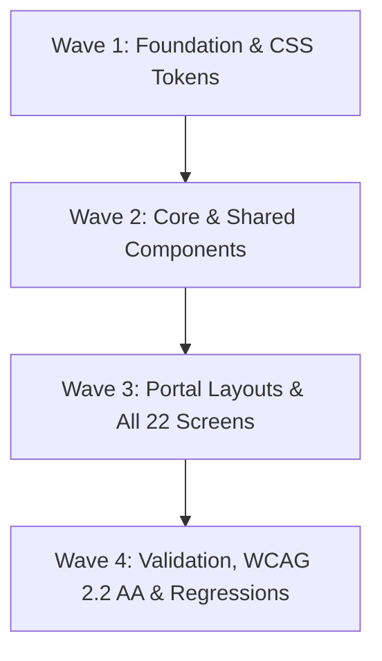

# Design Overhaul Implementation Plan
**Document ID:** `DOC-DES-10-PLAN`  
**Version:** 2.0  
**Date:** October 2026  
**Status:** Approved Implementation Blueprint  

---

## 1. Plan Overview & Objectives

This document establishes the precise, prioritized execution backlog for translating the **Secure SSI Platform Design System** (Docs 01–09) into the active React 18 production codebase in `apps/web/`.

### Core Commitments
- **Zero Breaking Changes to Backend APIs:** All existing REST contracts, schemas, and endpoint bindings remain intact.
- **Fail-Closed Verification Semantics Preserved:** All 6 frontend contract test suites must continue to pass with 0 failures.
- **Honest Cryptographic UX:** Explicit disclosure of complete credential transmission in `PresentationConsentPage.tsx` and `SelectiveDisclosureSheet.tsx`.
- **Preservation of Working Tree:** All existing modifications are respected without destructive git commands.

---

## 2. Prioritized Implementation Backlog

The overhaul executes in 4 sequential engineering waves:

### Wave 1: Foundation & Central CSS Tokens (`apps/web/src/styles.css`)
- **Objective:** Establish the comprehensive GovTech Sovereign Dark design tokens, typographic hierarchy, responsive grid utilities, high-contrast focus rings, and custom scrollbar overrides.
- **Key Deliverables:**
  - CSS custom properties (`--bg-app`, `--bg-surface`, `--bg-surface-elevated`, `--text-main`, `--color-primary`, `--focus-ring`, status tokens).
  - Utility classes: `.crypto-truncate`, `.crypto-full-wrap`, `.sr-only`, `.panel`, `.btn`, `.btn-primary`, `.btn-secondary`, `.btn-danger`, `.table-enterprise`.
  - Responsive media queries for mobile dock and institutional collapsible drawer.

### Wave 2: Shared Identity Component Refactoring (`apps/web/src/components/`)
- **Objective:** Ensure reusable components adhere strictly to the token system and accessibility standards.
- **Target Components:**
  - `StatusChip.tsx`: 6 canonical states (`ACTIVE`, `REVOKED`, `EXPIRED`, `QUARANTINE`, `PENDING`, `UNKNOWN`) with text + icon + color.
  - `TrustBadge.tsx`: Visual trust seal with registered identity and cryptographic fingerprint.
  - `CredentialCard.tsx`: Physical-digital credential card with responsive typography and status strip.
  - `SelectiveDisclosureSheet.tsx`: Honest full-disclosure consent notice and explicit checkbox.
  - `Modal.tsx`: Focus trap, escape key binding, ARIA dialog roles.
  - `QRCodeDisplay.tsx`: High-contrast rendering on dark surfaces with copy trigger and download button.
  - `NinePointVerificationMatrix.tsx`: Authoritative 9-gate verification matrix with real execution latencies.

### Wave 3: Screen-by-Screen Overhaul across 6 Portals (`apps/web/src/pages/`)
- **Holder Wallet:** `WalletDashboard.tsx`, `CredentialDetailPage.tsx`, `ScanQrPage.tsx`, `PresentationConsentPage.tsx`, `ActivityHistoryPage.tsx`, `SecuritySettingsPage.tsx`.
- **Issuer Portal:** `IssuerDashboard.tsx`, `CredentialTemplatesPage.tsx`, `IssueCredentialPage.tsx`, `RevocationRegistryPage.tsx`.
- **Verifier Portal:** `VerifierDashboard.tsx`, `CreateRequestPage.tsx`, `VerifyPresentationPage.tsx`, `VerificationHistoryPage.tsx`.
- **Guardian Console:** `GuardianDashboard.tsx`, `RecoveryRequestsPage.tsx`, `ApproveRecoveryPage.tsx`.
- **Admin Cockpit:** `AdminDashboard.tsx`, `SmartContractsPage.tsx`, `AuditExplorerPage.tsx`, `AiFraudMonitorPage.tsx`.
- **Public & Auth:** `LandingPage.tsx`, `EcosystemPage.tsx`, `ArchitectureDocsPage.tsx`, `AuthPage.tsx`, `NotFoundPage.tsx`.

### Wave 4: Validation & Quality Gates (Stages 9 & 10)
- **Frontend Build & Lint:** `npm.cmd run lint` (0 errors), `npm.cmd run build` (0 errors).
- **Web Contract Tests:** 6 test files via `node --experimental-strip-types` (all passing).
- **WCAG 2.2 AA Audit:** Contrast check, target sizes, focus visibility, keyboard navigation.
- **Git Diff & Whitespace Verification:** `git diff --check` (clean).

---

## 3. File & Component Impact Matrix

| File Path | Wave | Primary Changes |
| :--- | :--- | :--- |
| `apps/web/src/styles.css` | Wave 1 | Central design tokens, typography, button variants, table styles, responsive overrides |
| `apps/web/src/components/common/StatusChip.tsx` | Wave 2 | Token-based colors, icon mapping, bilingual labels, WCAG AA compliance |
| `apps/web/src/components/common/TrustBadge.tsx` | Wave 2 | Trust tier styling, tooltip accessibility, copyable fingerprint |
| `apps/web/src/components/credentials/CredentialCard.tsx` | Wave 2 | Visual card gradient, status stripe, claim preview, responsive flex |
| `apps/web/src/components/consent/SelectiveDisclosureSheet.tsx`| Wave 2 | Full credential disclosure notice, checkbox binding, accessibility |
| `apps/web/src/components/verification/NinePointVerificationMatrix.tsx` | Wave 2 | 9-gate checklist, latency badges, forensic evidence expanders |
| `apps/web/src/layouts/RootLayout.tsx` | Wave 3 | Sticky enterprise header, role switcher bar, network health indicator |
| `apps/web/src/layouts/HolderLayout.tsx` | Wave 3 | Mobile bottom dock, responsive margins, viewport padding |
| `apps/web/src/layouts/InstitutionalLayout.tsx` | Wave 3 | 260px collapsible sidebar, drawer toggle on mobile |
| `apps/web/src/pages/holder/WalletDashboard.tsx` | Wave 3 | Metric strip, credential card grid, empty state, guardian warning |
| `apps/web/src/pages/holder/PresentationConsentPage.tsx` | Wave 3 | Verifier purpose box, full-disclosure claim list, retry logic |
| `apps/web/src/pages/issuer/IssueCredentialPage.tsx` | Wave 3 | Dual-pane layout, schema selection, Ed25519 issuance, OID4VCI offer |
| `apps/web/src/pages/issuer/RevocationRegistryPage.tsx` | Wave 3 | Bitstring status list gauge, 2-step confirmation modal |
| `apps/web/src/pages/verifier/CreateRequestPage.tsx` | Wave 3 | DCQL request generator, high-contrast QR terminal, session polling |
| `apps/web/src/pages/verifier/VerifyPresentationPage.tsx` | Wave 3 | 9-point verification matrix integration, fail-closed handling |
| `apps/web/src/pages/guardian/ApproveRecoveryPage.tsx` | Wave 3 | Guardian quorum progress, out-of-band verification notice |
| `apps/web/src/pages/admin/AdminDashboard.tsx` | Wave 3 | Telemetry cards, service health indicators, gateway latency chart |
| `apps/web/src/pages/admin/AiFraudMonitorPage.tsx` | Wave 3 | Isolation Forest anomaly slider, quarantine queue, threat radar |

---

## 4. Backwards Compatibility & Risk Mitigation

| Identified Risk | Impact | Mitigation Strategy |
| :--- | :--- | :--- |
| **Direct Post CORS or Routing Mismatch** | High | Preserved all URL paths and gateway proxy rules; contract tests verify exact routes. |
| **False Selective Disclosure Perception** | High | Maintained unambiguous full-disclosure warning banner in all consent screens. |
| **CSS Class Clashes / Breakage** | Medium | Centralized all tokens in CSS variables (`--bg-surface`, etc.); no global destructive overrides. |
| **Keyboard Trapping in Modals** | Medium | `Modal.tsx` implements accessible focus trapping with explicit `Escape` key close. |
| **Mobile Horizontal Overflow** | Medium | Tables convert to card stacks below 768px; monospace hashes use `.crypto-truncate`. |

---

## 5. Verification & Acceptance Criteria

Every screen and component must satisfy the following checklist before delivery:
1. [ ] Follows GovTech Sovereign Dark color and typography tokens on every route; requires route-by-route visual review.
2. [ ] Interactive elements feature the shared `:focus-visible` teal outline (3px, 3px offset); verify by keyboard on each screen group.
3. [ ] Text contrast exceeds 4.5:1 (normal text) and 3:1 (large text / icons); verify the rendered color pairs.
4. [ ] Touch targets in Holder wallet are minimum 44x44px on all wallet routes.
5. [ ] Status is communicated via color, icon, and text simultaneously across all affected routes.
6. [ ] Verifier verification fails closed on any error or missing status; rerun the relevant security contract tests.
7. [x] Zero lint errors and successful production build; both were rerun on 19 October 2026.
8. [ ] All 6 frontend contract test suites pass completely. Only the authentication contract file (17 checks) was run in this continuation.

---

## 6. Responsive Web and Mobile Continuation — 19 October 2026

This continuation extends the existing screen plan to desktop, tablet and phone viewports. It does not replace the approved portal and workflow inventory above. The current repository contains `apps/web` but no Android/iOS project, Capacitor wrapper, native build files, or app-specific package. This implementation targets responsive browser use on phones and tablets; a separate native application remains out of scope until its codebase is available.

### 6.1 Viewport acceptance matrix

| Screen group | Desktop (≥1025px) | Tablet (768–1024px) | Phone (≤767px) | Current evidence/status |
| :--- | :--- | :--- | :--- | :--- |
| Public: home, ecosystem, architecture docs | Shared header, readable content width, balanced cards | Stacked hero/content, two-column entry cards where space allows | One-column entry cards, wrapped navigation, no horizontal page overflow | Home rendered at 655px browser width; document width matched viewport. Other pages still need visual review. |
| Sign-in | Split brand/story and sign-in panel | Compact two-column layout | Form first; role context and local project illustration below; full-width controls | CSS provides form-first layout at ≤767px. Verify all account states and role hints. |
| Holder wallet | Wide credential workspace, top navigation | Two-column content where it fits | Bottom navigation, 44px+ targets, safe-area padding, single-column cards | Responsive layout exists; route-by-route mobile review remains. |
| Issuer and verifier | Persistent institutional navigation and dense work area | Collapsible navigation drawer, reflowed forms and result cards | Drawer navigation, one-column forms/cards, no obscured actions | Drawer now hides closed navigation from focus and locks background scrolling while open; route-by-route review remains. |
| Guardian and admin | Persistent institutional navigation | Collapsible navigation drawer | Drawer navigation and bottom safe-area clearance | Shared shell behavior updated; route-by-route review remains. |

### 6.2 Current implementation checkpoint

- The sign-in artwork uses the repository’s local SSI trust-network illustration, so it no longer depends on a third-party image host.
- The institutional drawer closes with Escape or its backdrop, prevents background scrolling while open, and does not leave hidden navigation links keyboard-focusable.
- Phone and tablet institutional content reserves space above the fixed menu control and accounts for device safe areas.
- Keyboard focus uses the shared teal focus token; warning amber remains reserved for warning and expiry states.
- The sign-in profile links are presentation hints only. Server-validated account roles and the existing role-home redirect remain authoritative.
- Browser checks: sign-in at 320px, 390px, and 768px; Ecosystem and Architecture Docs at 390px; Holder wallet at the available 655px viewport. Each checked route had no horizontal overflow. The page document reserves 10px for the stable scrollbar, so its measured width is 10px below the viewport on some screens.
- Ecosystem loaded successfully in both phone and desktop-sized browser views: four credential format entries were returned and the public issuer registry truthfully displayed zero published issuers. Architecture Docs rendered four service cards at phone width.
- The Holder wallet rendered its empty state and bottom navigation at 655px; no credential records were present to exercise credential-detail actions.
- This checkpoint does not verify all role dashboards, all workflow states, or all routes. Issuer, verifier, guardian, and admin responsive acceptance remains pending.
- The web project has no native app or PWA manifest/service worker. Phone and tablet browser behavior is implemented here; installable or native Android/iOS delivery remains separate work.

### 6.3 Remaining screen validation

Do not mark the full redesign complete from the single home-page check. Review every route in the screen inventory above at desktop, tablet and phone widths; verify empty, loading, success and error states; check tables, long identifiers, dialogs, keyboard navigation, and authorized role flows. Capture final screenshots only after the corresponding routes have been opened at each target size. A native Android/iOS app cannot be claimed complete from this web-only repository.
