# Secure SSI Platform - Architecture & Protocol Diagram Package

**Project**: Academic Secure SSI Platform (Graduation Thesis Reference Implementation)  
**Standard**: W3C VC DM v2.0, OpenID4VCI (Draft 13), OpenID4VP (Draft 20), EIP-4337, RFC 8785 (JCS)  
**Format**: Version-controlled, reproducible Mermaid diagrams  
**Scope**: Sprint 24 Final System Documentation  

---

## Table of Contents
- [D01 — High-Level System Architecture](#d01--high-level-system-architecture)
- [D02 — Stakeholder Role Ecosystem](#d02--stakeholder-role-ecosystem)
- [D03 — Holder Credential Lifecycle](#d03--holder-credential-lifecycle)
- [D04 — OID4VCI Credential Issuance Protocol](#d04--oid4vci-credential-issuance-protocol)
- [D05 — OID4VP Verifiable Presentation Protocol](#d05--oid4vp-verifiable-presentation-protocol)
- [D06 — 9-Point Verification Decision Matrix](#d06--9-point-verification-decision-matrix)
- [D07 — Consent & Data Minimization Flow](#d07--consent--data-minimization-flow)
- [D08 — Guardian Social Recovery (3-of-5 Shamir)](#d08--guardian-social-recovery-3-of-5-shamir)
- [D09 — AI Fraud Risk Scoring Pipeline](#d09--ai-fraud-risk-scoring-pipeline)
- [D10 — EVM Blockchain Integrity Anchoring](#d10--evm-blockchain-integrity-anchoring)
- [D11 — Security Boundaries & STRIDE Threat Model](#d11--security-boundaries--stride-threat-model)
- [D12 — Deployment & Runtime Process Architecture](#d12--deployment--runtime-process-architecture)
- [D13 — Conceptual Persistence & Data Model](#d13--conceptual-persistence--data-model)

---

## D01 — High-Level System Architecture

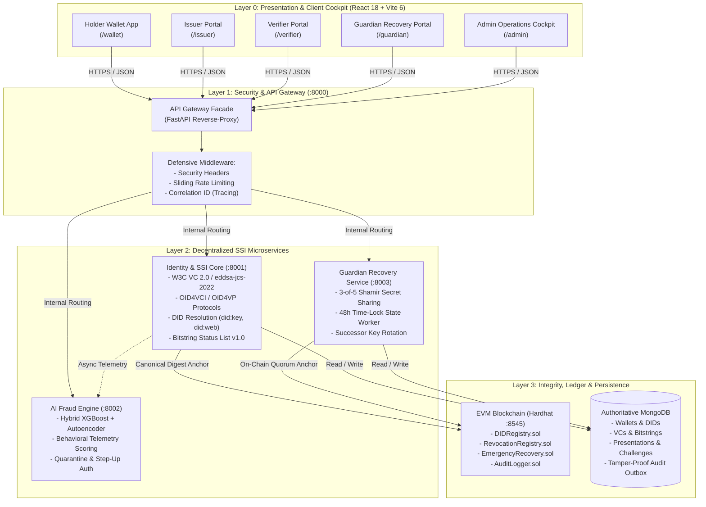

---

## D02 — Stakeholder Role Ecosystem

```mermaid
graph LR
    subgraph Stakeholders ["SSI Platform Multi-Stakeholder Ecosystem"]
        H["Holder<br/>(Citizen / Student / User)<br/>• Sovereign Key Custody<br/>• Selective Disclosure Consent<br/>• Presentation Generation"]
        I["Issuer<br/>(University / Authority)<br/>• Schema & Template Design<br/>• Credential Issuance<br/>• Status List Revocation"]
        V["Verifier<br/>(Employer / Service)<br/>• Presentation Request Creation<br/>• 9-Point Trust Verification<br/>• Verification Audit Logs"]
        G["Guardian<br/>(Trusted Contact / Institution)<br/>• Shamir Share Custody<br/>• Recovery Petition Review<br/>• Quorum Signing (3-of-5)"]
        A["Platform Admin<br/>(System Operator)<br/>• Node & Service Health<br/>• Smart Contract Anchors<br/>• Tamper-Evident Audit Trail"]
    end

    I -->|1. Issues W3C Credential (OID4VCI)| H
    V -->|2. Presentation Request (OID4VP)| H
    H -->|3. Verifiable Presentation (JCS Proof)| V
    V -->|4. Status Verification Query| I
    H -.->|5. Emergency Recovery Petition| G
    G -.->|6. Threshold Quorum Approval| H
    A -.->|7. Observability & Anchoring Audit| Stakeholders
```

---

## D03 — Holder Credential Lifecycle

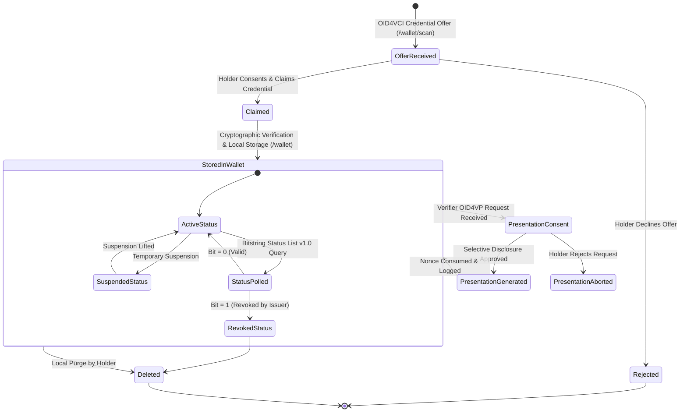

---

## D04 — OID4VCI Credential Issuance Protocol

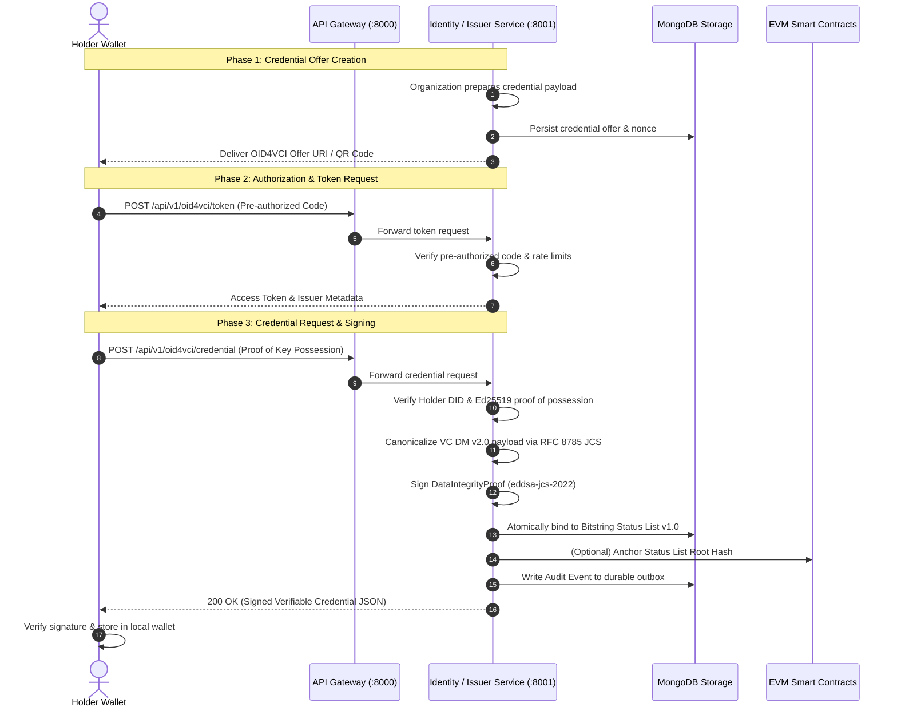

---

## D05 — OID4VP Verifiable Presentation Protocol

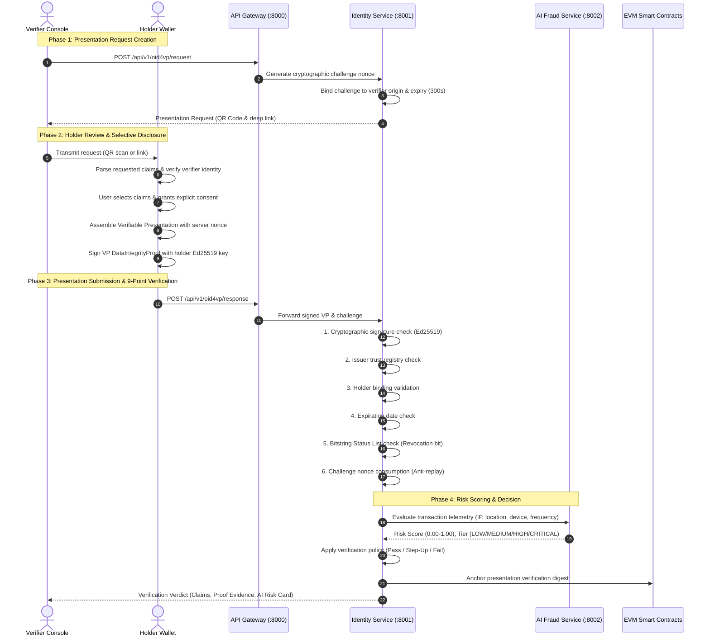

---

## D06 — 9-Point Verification Decision Matrix

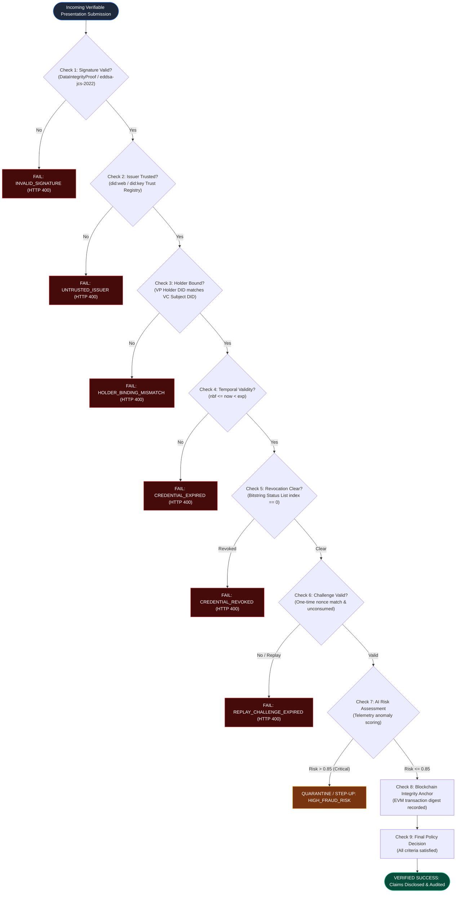

---

## D07 — Consent & Data Minimization Flow

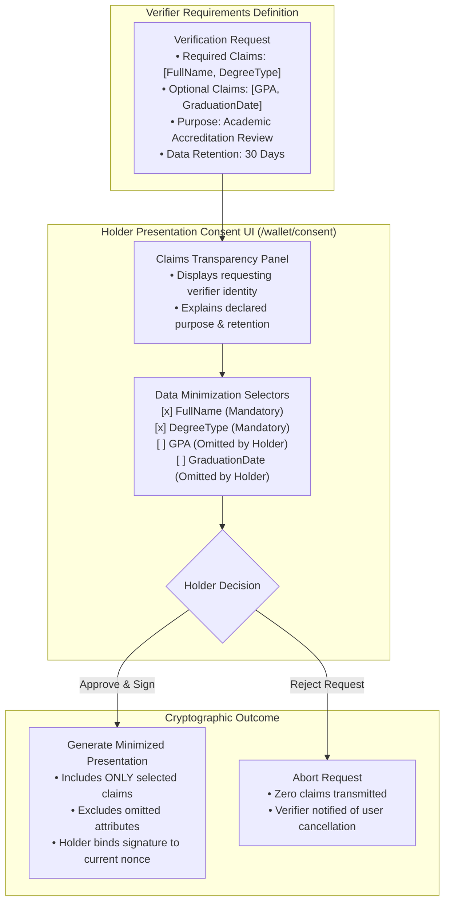

---

## D08 — Guardian Social Recovery (3-of-5 Shamir)

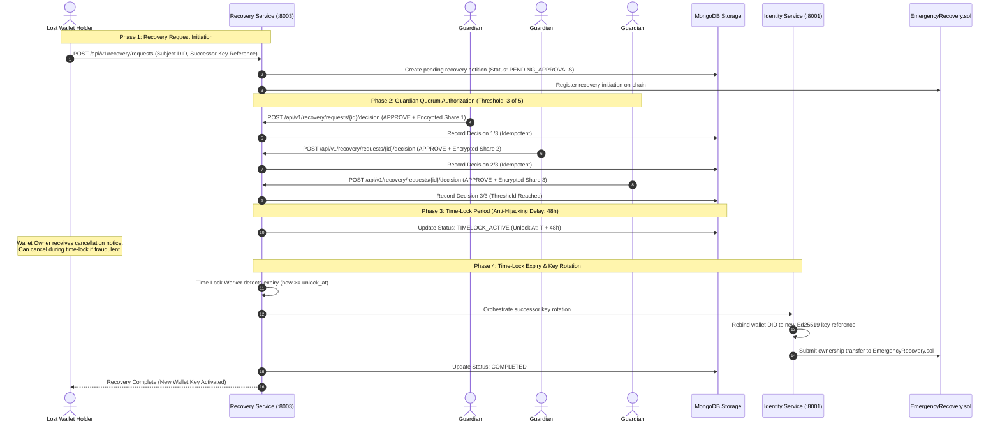

---

## D09 — AI Fraud Risk Scoring Pipeline

```mermaid
flowchart LR
    subgraph Ingestion ["Telemetry Ingestion"]
        E1["IP Address & ASN"]
        E2["Geo-Coordinates"]
        E3["Device / User-Agent"]
        E4["Timestamp & Cadence"]
        E5["Failure Counts"]
    end

    subgraph Feature_Engineering ["Feature Extraction Engine"]
        F1["Impossible Travel Velocity (km/h)"]
        F2["Tor / Proxy / VPN Exit Detection"]
        F3["Rapid Brute-Force Rate"]
        F4["Out-of-Hours Presentation"]
        F5["Unusual User-Agent Entropy"]
    end

    subgraph Model_Inference ["Hybrid AI Inference Engine (:8002)"]
        XGB["XGBoost Classifier<br/>(Supervised Tabular Risk)<br/>Weight: 0.60"]
        AE["PyTorch Autoencoder<br/>(Unsupervised Anomaly Reconstruction)<br/>Weight: 0.40"]
        Score["Ensemble Risk Score Calculator<br/>Score = 0.60(XGB) + 0.40(AE_Loss)"]
    end

    subgraph Decision ["Risk Tier & Policy Action"]
        T1["LOW (0.00 - 0.30)<br/>Verdict: ALLOW"]
        T2["MEDIUM (0.31 - 0.60)<br/>Verdict: ALLOW with Audit Flag"]
        T3["HIGH (0.61 - 0.85)<br/>Verdict: STEP-UP MFA REQUIRED"]
        T4["CRITICAL (0.86 - 1.00)<br/>Verdict: AUTO-QUARANTINE"]
    end

    Ingestion --> Feature_Engineering
    Feature_Engineering --> XGB
    Feature_Engineering --> AE
    XGB --> Score
    AE --> Score
    Score --> Decision
```

---

## D10 — EVM Blockchain Integrity Anchoring

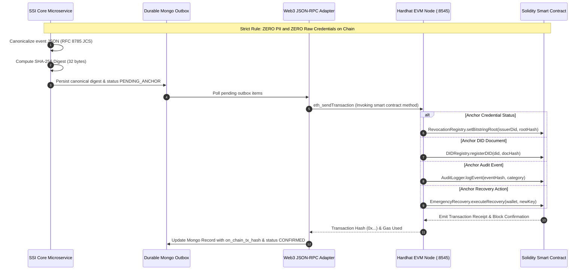

---

## D11 — Security Boundaries & STRIDE Threat Model

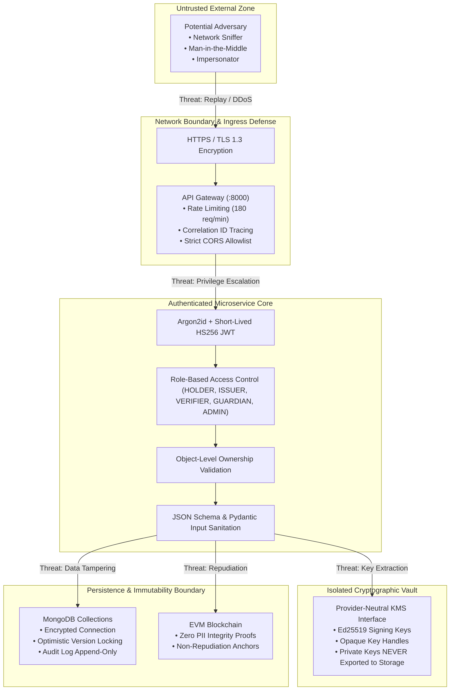

---

## D12 — Deployment & Runtime Process Architecture

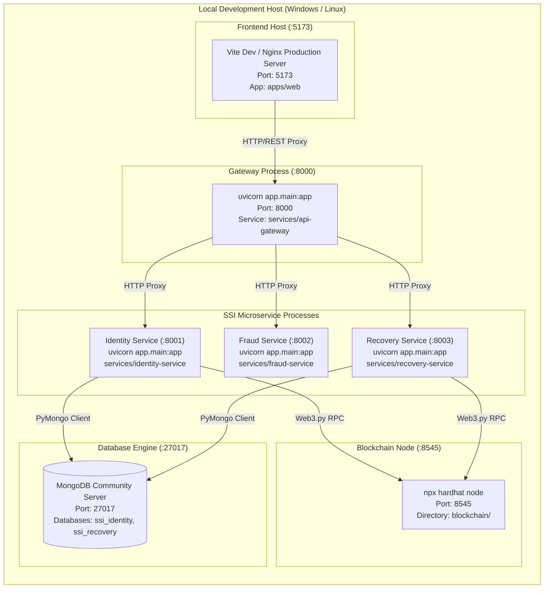

---

## D13 — Conceptual Persistence & Data Model

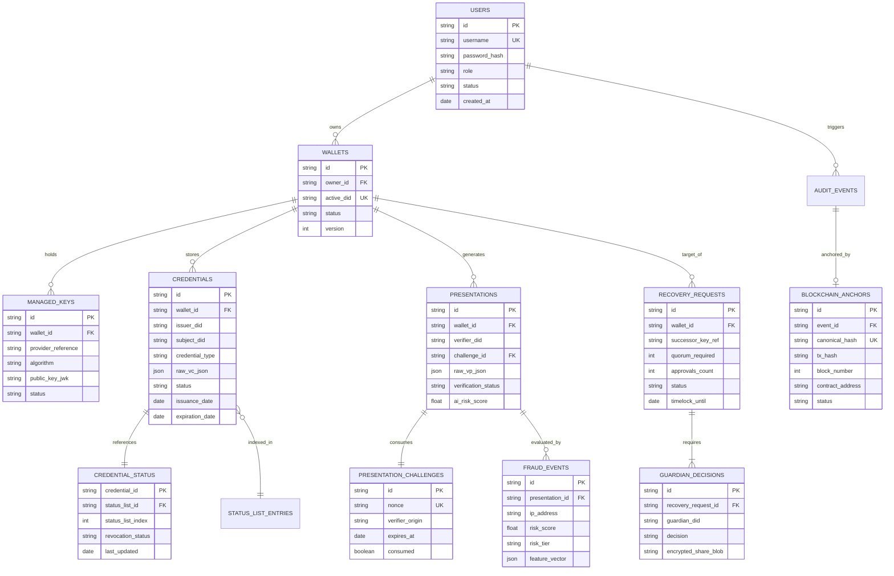
