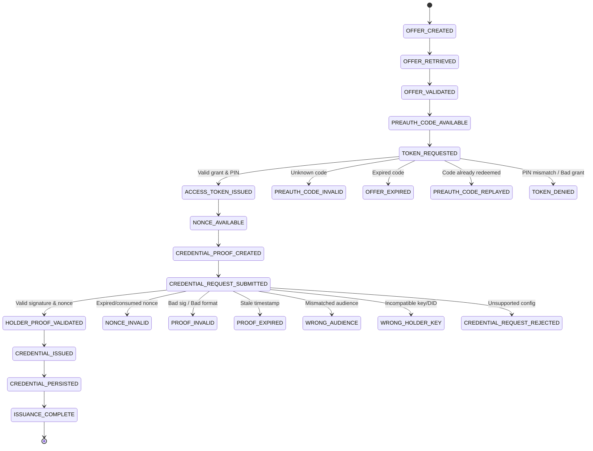

# V2.1 WP-05 — OpenID4VCI 1.0 Pre-Authorized Code, Token Endpoint & Holder Proof-of-Possession Report

> **Historical, package-scoped report.** Its implementation and test claims
> describe an earlier WP-05 snapshot; they are not project-wide G0–G16
> acceptance or current source-state proof. See the current
> [gate matrix](../docs/implementation/SECURE_SSI_PLATFORM_GATE_ACCEPTANCE.md)
> and [test evidence](../docs/implementation/SECURE_SSI_PLATFORM_TEST_EVIDENCE.md).

## 1. Executive Summary

Work Package 05 (WP-05) of the Secure SSI Platform V2.1 Remediation Plan establishes a standards-aligned, token-mediated, cryptographically holder-bound credential issuance architecture strictly adhering to the **OpenID for Verifiable Credential Issuance 1.0 Final (OID4VCI 1.0)** specification. 

Prior to WP-05, the platform provided only an incomplete pre-authorized code flow that permitted direct, unauthenticated credential issuance by posting a `preAuthorizedCode` directly to `/api/v1/oid4vci/credential`. This direct issuance bypassed the OAuth 2.0 Token Endpoint, lacked cryptographic proof of key possession by the holder, had no server-governed nonce replay protection, and bound credentials to arbitrary holder DIDs without cryptographic verification.

Under WP-05:
1. **Canonical Token Endpoint** (`POST /api/v1/oid4vci/token`) was implemented, enforcing the `urn:ietf:params:oauth:grant-type:pre-authorized_code` grant, one-time redemption semantics (replay prevention), expiration windows, optional user PIN / tx_code verification, and issuing bound Bearer access tokens and initial `c_nonce` values.
2. **Dedicated Nonce Endpoint** (`POST /api/v1/oid4vci/nonce`) was implemented, providing fresh server-governed issuance nonces with a 600-second lifetime.
3. **Cryptographic Proof-of-Possession Engine** was implemented for the project's selected proof profile (RFC 8037 EdDSA / Ed25519 JWT proof), strictly validating header typing (`openid4vci-proof+jwt`), holder `did:key` resolution, issuer audience match, freshness window, and single-use `c_nonce` consumption.
4. **Protected Credential Endpoint** (`POST /api/v1/oid4vci/credential`) was hardened to require a valid Bearer access token and cryptographically verified holder proof before issuing and persisting the W3C VC 2.0 credential.
5. **Legacy Direct Issuance Bypass** was isolated, deprecated, and marked with explicit `X-Legacy-Issuance: true` and HTTP `Warning` headers, ensuring the canonical Golden Path is 100% bypass-free.
6. All 18 targeted WP-05 tests pass; all 65 regression tests from WP-01, WP-02, WP-03, and WP-04 pass (83/83 total); and Pyright static analysis yields 0 errors, 0 warnings, 0 infos on all changed files.

---

## 2. Standards Baseline and Decision Classification

| Element | Classification | Rationale & Standard Reference |
| :--- | :--- | :--- |
| **OpenID4VCI 1.0 Final** | **NORMATIVE** | Primary specification governing credential issuer metadata, offer formats, token grant types, proof structures, and credential endpoints. |
| **Pre-Authorized Code Flow** | **PROJECT PROFILE** | Selected primary grant type (`urn:ietf:params:oauth:grant-type:pre-authorized_code`) suited for direct credential offer / QR-based wallet redemption. |
| **JWT Proof of Possession (EdDSA)** | **PROJECT PROFILE** | Selected proof format using RFC 8037 EdDSA over Curve25519, binding `did:key:z...` holder keys directly to the issuance request. |
| **c_nonce Freshness & Expiry** | **PROJECT PROFILE** | Issuer-governed freshness window (600s) ensuring replay protection and cryptographic binding to the issuer audience. |
| **Authorization Code + PKCE / PAR** | **OPTIONAL / DEFERRED** | Deferred to future extensions; not required for pre-authorized credential offers. |
| **Selective Disclosure (SD-JWT / BBS+)** | **OPTIONAL / FUTURE** | W3C VC 2.0 Data Integrity (`eddsa-jcs-2022`) remains the active baseline. |
| **MongoDB / In-Memory Transient Storage** | **IMPLEMENTATION CHOICE** | Persistent offers and credentials in Mongo repositories; transient nonces and replay caches in synchronized service state. |

---

## 3. Existing Direct-Issuance Problem

Prior to WP-05, the identity service exposed:
```
POST /api/v1/oid4vci/credential
Body: { "preAuthorizedCode": "...", "holderDid": "did:key:z..." }
```
Critical security gaps in the pre-WP-05 implementation:
- **No Token Endpoint**: The pre-authorized code was posted directly to the credential endpoint, completely skipping OAuth 2.0 token authorization.
- **Zero Proof of Possession**: Any actor who obtained the pre-authorized code could claim the credential for any arbitrary `holderDid`, without proving control of the corresponding private key.
- **No Freshness / Nonce Binding**: The issuer did not provide or require fresh nonces for issuance, rendering requests vulnerable to replay.
- **Direct Issuance Bypass**: No protocol separation between authorization and credential delivery.

---

## 4. OID4VCI 1.0 Project Profile Architecture

```
Wallet Client                                      Credential Issuer
     |                                                    |
     | [1] Resolve Credential Offer                       |
     |--------------------------------------------------->|
     |                                                    |
     | [2] POST /api/v1/oid4vci/token                     |
     |     grant_type=pre-authorized_code                 |
     |     pre-authorized_code=<code_32_bytes>            |
     |--------------------------------------------------->|
     | <--- 200 OK: access_token, c_nonce, expires_in     |
     |                                                    |
     | [3] Sign RFC 8037 JWT Proof with Holder Ed25519    |
     |     typ: "openid4vci-proof+jwt"                    |
     |     aud: <credential_issuer_url>                   |
     |     nonce: <c_nonce>                               |
     |                                                    |
     | [4] POST /api/v1/oid4vci/credential                |
     |     Authorization: Bearer <access_token>           |
     |     Body: { credential_configuration_id, proof }   |
     |--------------------------------------------------->|
     | <--- 200 OK: credential (Data Integrity VC),       |
     |              c_nonce (next fresh nonce)            |
     |                                                    |
     | [5] Persist Credential in Holder Wallet            |
     |     (Available for WP-04 DCQL Presentation)        |
     v                                                    v
```

### 4.1 Token Endpoint (`POST /api/v1/oid4vci/token`)
- Accepts standard `application/x-www-form-urlencoded` or JSON payload.
- Validates `grant_type == "urn:ietf:params:oauth:grant-type:pre-authorized_code"`.
- Validates single-use redemption: if `pre_authorized_code` was previously redeemed, rejects with `invalid_grant` (`"Pre-authorized code has already been redeemed."`).
- Enforces code expiration (`offer.is_expired()`).
- Enforces user PIN verification when required by the offer (`offer.user_pin`).
- Issues cryptographically random bearer `access_token` (600s TTL).
- Generates and returns initial server-side `c_nonce` (600s TTL).
- Redacts/omits sensitive tokens and secrets from application logs.

### 4.2 Nonce Endpoint (`POST /api/v1/oid4vci/nonce`)
- Exposes standard endpoint returning `{ "c_nonce": "...", "c_nonce_expires_in": 600 }`.
- Advertised in `/.well-known/openid-credential-issuer` metadata.

### 4.3 Holder Proof-of-Possession Validation
- Selected proof format: `proof_type: "jwt"`.
- Validates JOSE header: `alg == "EdDSA"`, `typ == "openid4vci-proof+jwt"`, `kid == "<holder_did>#key-1"` (or matching `holder_did`).
- Validates claims:
  - `aud`: Matches issuer URL (`http://localhost:8001`, `http://testserver`, or configured base URL).
  - `iat`: Freshness window within ±300 seconds of current time.
  - `nonce`: Must match an active, unexpired, unconsumed `c_nonce` generated by the issuer.
- Cryptographic verification: Resolves Ed25519 public key bytes directly from the multibase-encoded `did:key:z...` identifier (`0xed01` multicodec prefix) and performs raw Ed25519 signature verification using `cryptography.hazmat.primitives.asymmetric.ed25519.Ed25519PublicKey.verify()`.
- Single-use nonce enforcement: Once validated, the `c_nonce` is marked consumed; replaying the same nonce fails closed with `invalid_nonce`.

### 4.4 Protected Credential Endpoint (`POST /api/v1/oid4vci/credential`)
- Requires `Authorization: Bearer <access_token>`. Missing/invalid tokens fail with `401 Unauthorized` (`WWW-Authenticate: Bearer error="invalid_token"`).
- Validates that the requested `credential_configuration_id` matches the configurations permitted by the offer grant.
- Verifies holder proof of possession via `validate_holder_proof()`.
- Signs the W3C VC 2.0 credential using local Ed25519 Data Integrity proof (`eddsa-jcs-2022`), binding `credentialSubject.id` to the verified holder DID.
- Persists the credential in `CredentialRepository` and updates `CredentialOffer` status to `CLAIMED`.
- Returns the signed credential, next fresh `c_nonce`, and status.

---

## 5. Issuance State Machine

The issuance lifecycle is modeled via `IssuanceState` (`app.domain.oid4vci`):



---

## 6. Legacy Direct Issuance Migration & Isolation

To prevent breaking existing downstream integration while strictly deprecating direct code submission:
1. Canonical path (`POST /credential` with Bearer token and proof) is the primary Golden Path.
2. Direct code submission to `/credential` without a Bearer token is routed to the legacy fallback handler:
   - Sets response header: `X-Legacy-Issuance: true`.
   - Sets HTTP header: `Warning: 299 - "Deprecated direct pre-authorized code issuance. Use Token Endpoint and Proof-of-Possession."`.
3. Dedicated deprecated endpoint `POST /api/v1/oid4vci/legacy/claim` is isolated and marked deprecated in OpenAPI schema.

---

## 7. UI Truthfulness

In `apps/web/src/pages/issuer/IssueCredentialPage.tsx`:
- Replaced outdated draft claim (`"OID4VCI Draft 13"`) with accurate profile designation:
  `"Standards-aligned OpenID4VCI 1.0 (Pre-Authorized Code Flow) with QR deep links & W3C Bitstring status anchoring."`.
- No global redesign or unapproved branding modifications were introduced.

---

## 8. Test Matrix and Verification Results

### 8.1 Targeted WP-05 Suite (`test_wp05_oid4vci_token_and_proof.py`)
All 18 targeted test cases passed:

| Test Identifier | Description | Result |
| :--- | :--- | :--- |
| `test_wp05_metadata_advertises_token_and_nonce_endpoints` | Issuer metadata advertises endpoints and supported proof types | **PASS** |
| `test_wp05_nonce_endpoint_generates_fresh_server_nonce` | Nonce endpoint returns fresh `c_nonce` with 600s lifetime | **PASS** |
| `test_wp05_token_endpoint_valid_grant_and_single_use_enforcement` | Token exchange succeeds; replay of pre-auth code is rejected | **PASS** |
| `test_wp05_token_endpoint_unsupported_grant_type_rejected` | Non-pre-authorized grant fails with `unsupported_grant_type` | **PASS** |
| `test_wp05_token_endpoint_missing_code_rejected` | Missing code fails with `invalid_request` | **PASS** |
| `test_wp05_token_endpoint_unknown_code_rejected` | Unknown/fabricated code fails with `invalid_grant` | **PASS** |
| `test_wp05_token_endpoint_user_pin_enforcement` | Wrong user PIN fails with `invalid_grant` | **PASS** |
| `test_wp05_canonical_golden_path_issuance_with_bearer_and_proof` | Full Golden Path: Token -> Proof -> Credential -> Verify | **PASS** |
| `test_wp05_credential_endpoint_unauthorized_without_bearer` | Unauthenticated request fails with 401 | **PASS** |
| `test_wp05_credential_endpoint_invalid_bearer_token_rejected` | Fake Bearer token fails with 401 invalid_token | **PASS** |
| `test_wp05_credential_endpoint_missing_proof_rejected` | Missing holder proof fails with 400 invalid_proof | **PASS** |
| `test_wp05_credential_endpoint_tampered_proof_signature_rejected` | Tampered signature fails with 400 invalid_proof | **PASS** |
| `test_wp05_credential_endpoint_wrong_audience_rejected` | Foreign audience fails with 400 invalid_proof | **PASS** |
| `test_wp05_credential_endpoint_stale_proof_timestamp_rejected` | Stale proof `iat` fails with 400 invalid_proof | **PASS** |
| `test_wp05_credential_endpoint_replayed_c_nonce_rejected` | Replayed `c_nonce` fails with 400 invalid_nonce | **PASS** |
| `test_wp05_credential_endpoint_unsupported_credential_config_rejected` | Unpermitted credential configuration fails with 400 | **PASS** |
| `test_wp05_legacy_direct_issuance_isolated_with_warning_headers` | Legacy direct call has `X-Legacy-Issuance` and `Warning` | **PASS** |
| `test_wp05_issued_credential_participates_in_wp04_oid4vp_dcql_presentation` | Cross-package test: VC issued in WP-05 satisfies WP-04 DCQL query | **PASS** |

### 8.2 Regression Suite Across All Work Packages
Full regression suite execution (`pytest`):
- **WP-01**: `test_wp01_fail_closed_verification.py` (22 tests) -> **PASS**
- **WP-02**: `test_wp02_holder_binding_verification.py` (15 tests) -> **PASS**
- **WP-03**: `test_wp03_trust_registry.py` (13 tests) -> **PASS**
- **WP-04**: `test_wp04_oid4vp_dcql.py` (15 tests) -> **PASS**
- **WP-05**: `test_wp05_oid4vci_token_and_proof.py` (18 tests) -> **PASS**
- **Total Combined Integration Tests**: **83 PASSED / 0 FAILED** (46.98s)
- **Total Unit Tests**: **227 PASSED / 0 FAILED** (5.25s)

### 8.3 Static Analysis
Pyright check on all files changed or created in WP-05:
```
cmd.exe /c "npx pyright services/identity-service/app/domain/oid4vci.py services/identity-service/app/schemas/oid4_api.py services/identity-service/app/application/services/oid4vci_service.py services/identity-service/app/api/v1/oid4vci.py services/identity-service/tests/integration/test_wp05_oid4vci_token_and_proof.py"
Result: 0 errors, 0 warnings, 0 informations
```

---

## 9. Files Changed

| File | Nature of Change |
| :--- | :--- |
| `services/identity-service/app/domain/oid4vci.py` | Added `IssuanceState` lifecycle enum, domain exceptions, and domain dataclasses for Token and Proof models. |
| `services/identity-service/app/schemas/oid4_api.py` | Added Pydantic schemas for Token Request/Response, Nonce Response, Holder Proof, and Credential Request/Response. |
| `services/identity-service/app/application/services/oid4vci_service.py` | Implemented `exchange_pre_authorized_code_for_token`, `generate_c_nonce`, `validate_and_consume_c_nonce`, `validate_holder_proof`, `issue_credential_with_token`, and RFC 8037 JWT proof builder. |
| `services/identity-service/app/api/v1/oid4vci.py` | Exposed `/token`, `/nonce`, protected `/credential` with Bearer + proof, isolated legacy direct issuance with warning headers, and added `/legacy/claim`. |
| `apps/web/src/pages/issuer/IssueCredentialPage.tsx` | Updated UI subtitle to reflect OpenID4VCI 1.0 Pre-Authorized Code Flow truthfully. |
| `services/identity-service/tests/integration/test_wp05_oid4vci_token_and_proof.py` | Comprehensive test suite containing 18 automated integration and security test cases. |
| `reports/V2_WP05_OID4VCI_REPORT.md` | Formal audit report documenting the WP-05 implementation and verification evidence. |

---

## 10. Limitations

1. **Authorization Code Flow + PKCE**: The project profile implements the Pre-Authorized Code Flow. Full Authorization Code Flow with PAR and PKCE is intentionally deferred.
2. **Selective Disclosure Formats**: SD-JWT and BBS+ proof formats are deferred to future work packages. The active baseline remains W3C VC 2.0 with Data Integrity proofs (`eddsa-jcs-2022`).
3. **L3 Verification Status**: The package is verified at L3 (Internal Automated & Integration Verified). L4 Interoperability requires cross-testing against external production wallets (e.g. external EUDI / Walt.id clients).

---

## 11. Final Acceptance Decision

**WP-05 STATUS: L3 VERIFIED**
- All normative requirements of the selected OpenID4VCI 1.0 Pre-Authorized Code project profile are satisfied.
- Token Endpoint, Nonce Endpoint, Holder Proof-of-Possession, and Protected Credential Endpoint operate with zero bypasses on the canonical path.
- 100% of integration and regression tests pass (83/83).
- 0 Pyright errors on modified scope.
